# GraphysX-screen — l'écran de l'île

**Les noms** (choisis par le propriétaire le 2026-10-29), pour ne plus confondre l'écran et
les terrains :

| Nom | Ce que c'est |
|---|---|
| **GraphysX-screen** | l'écran : cette page (`?app=island`). Elle dessine une île en direct ou en reprise ; elle ne simule rien. |
| **Île Clawblox** | un terrain : l'île Mesa simulée par Clawblox (`clawblox run`, `clawblox replay`). |
| **L'île de Frank** | l'autre terrain : la même île simulée par le service de monde de ce dépôt (`world-service/`), en service sur UGFrank depuis le 2026-10-29. |

GraphysX-screen affiche l'un ou l'autre terrain : seule l'adresse `source=` change.

## L'île Clawblox avec le rendu GraphysX

`?app=island` affiche l'île « Is this machine playing? » reconstruite dans Clawblox (moteur
Rust/Rapier, protocole agent HTTP) avec le rendu de GraphysX : ciel, eau réfléchissante,
ombres, matériaux, interface. **Clawblox reste l'autorité** de la physique et de l'agent :
cette page ne simule rien, elle dessine l'état que Clawblox diffuse.

Depuis le 2026-10-29 (phase 3 du service de monde), la même page affiche aussi une île
**du service de monde** (`world-service/`), en direct ou en reprise : seule l'adresse
`source=` change (section suivante). Celle qui tourne sur UGFrank s'appelle l'île de Frank.

## Ouvrir la vue

Sur devX, dans ce dépôt :

```bash
npx vite --host 0.0.0.0 --port 4231
```

puis, depuis un navigateur du réseau local :

| Ce qu'on veut voir | Adresse |
| --- | --- |
| Essai 1 (reprise, port 18090) | `http://192.168.2.117:4231/?app=island&source=http://192.168.2.117:18090` |
| Essai 2 (reprise, port 18091) | `http://192.168.2.117:4231/?app=island&source=http://192.168.2.117:18091` |
| Une île en direct (`clawblox run … --port 18086`) | `http://192.168.2.117:4231/?app=island&source=http://192.168.2.117:18086#spectator_token=<jeton>` |
| Sans serveur : courte capture réelle en boucle | `http://192.168.2.117:4231/?app=island` |

- `source=` est l'adresse d'un `clawblox run` (direct) ou d'un `clawblox replay` (reprise).
  La page le reconnaît seule : une reprise répond à `/replay/info`, un monde en direct non.
- Le jeton spectateur d'un monde en direct passe dans le **fragment** (`#spectator_token=…`),
  jamais dans la query string. `clawblox run` l'affiche au démarrage ; on peut le fixer avec
  `WORLD_SPECTATOR_TOKEN`.
- `embed=1` retire le bouton Quitter et compacte l'en-tête (pour l'onglet « Île » de Benchmark).

## Une île du service de monde (l'île de Frank)

L'île de Frank, en service sur UGFrank, se regarde à
`https://agentx.specialblend.icu:18793/?app=island&embed=1&source=https://agentx.specialblend.icu:18794&agent=Eko`
(réseau maison). Les exemples ci-dessous montent une île du service de monde sur devX pour
l'essayer.

Le service de monde (`world-service/`, docs/WORLD_SERVICE_DESIGN.md) parle le protocole agent
de Clawblox, mais diffuse ses spectateurs autrement : un flux SSE `GET /spectate` (document v2
au départ, poses 10 fois par seconde, ajouts et retraits d'objets, actions des agents). La page
le reconnaît seule : `GET /healthz` répond `{ok, tick}` **et** `GET /spectate` répond
`text/event-stream`. Un serveur Clawblox répond 404 à `/healthz` et garde son chemin d'avant.

Sur devX (exemple, ports libres au moment de l'essai) :

```bash
npm run build:world-service
npm run serve:world -- --host 0.0.0.0 --port 18140 --record --record-dir /tmp/ile/rec
node world-service/replay.mjs /tmp/ile/rec --host 0.0.0.0 --port 18141   # reprise de cet enregistrement
npx vite --host 0.0.0.0 --port 18143
```

| Ce qu'on veut voir | Adresse |
| --- | --- |
| L'île en direct, caméra sur Eko | `http://192.168.2.117:18143/?app=island&source=http://192.168.2.117:18140&agent=Eko` |
| La reprise de l'enregistrement | `http://192.168.2.117:18143/?app=island&source=http://192.168.2.117:18141&agent=Eko` |
| Comme l'onglet « Île » de Benchmark | ajouter `&embed=1` |

**L'île vivante** (`--world living-island`, docs/LIVING_ISLAND.md) passe par la même page : ses
arbres (`dna-tree`), sa volée et son vent arrivent dans le document du `hello`. Les oiseaux
volent parce que chaque image du flux porte leurs positions (`swarms`, interpolées comme les
poses), la volée locale restant en pause ; un arbre qui pousse ou change de génération est
renvoyé sous le même identifiant et la page le reconstruit. Parcours : `scripts/smoke-living-island.mjs`.

Le contrat de l'onglet « Île » (AgentX#1179,
`<vue>/?app=island&embed=1&source=<base>[#spectator_token=…]&agent=<nom>`) fonctionne tel quel :
il suffit que `source` désigne le service de monde ou sa reprise. Le service n'a pas de jeton
spectateur ; un `#spectator_token=` éventuel est ignoré.

Ce qui change par rapport à une île Clawblox :

- **Le document vient du serveur.** La page charge le document v2 reçu (`hello`) dans une
  portée transitoire (`graphysx-world`, étiquette `world-part`), sans `physics` et avec la
  physique locale **en pause** : rien ne simule ici. Elle garde l'apparence du document et ne
  complète que ce qu'il ne dit pas (ciel `clearblue`, éclairage, distances de brouillard).
- **Les poses** arrivent 10 fois par seconde ; la page les place avec `applyHostPoses` (sans
  révision ni annulation), interpolées environ 150 ms en arrière.
- **Les objets qui apparaissent ou disparaissent** (cubes d'ardoise de l'impact du rocher,
  blocs tombés hors de l'île, agent qui arrive) mettent la portée à jour.
- **`&agent=<nom>`** choisit l'agent suivi ; s'il y a plusieurs sessions de ce nom (un monde
  qui dure garde les anciennes), la plus récente. Sans nom : le premier arrivé.
- **Panneau** : chaque action de l'agent avec son résultat (`Pickup (14.2, 0.4, -2.1) →
  PickupSuccess`). Un déplacement ou un saut ne change pas `LastActionResult` (comme dans
  Clawblox) : la page ne lui accole donc pas un résultat ancien.
- **Reprise** : `world-service/replay.mjs` répond comme `clawblox replay` (`/replay/info`,
  lecture, pause, recherche, vitesse, saut des temps morts, lecture partagée par tous). Après
  chaque recherche, le serveur renvoie le document à ce tick : la page repart de là. Ouverte en
  `embed=1` au début d'une reprise en pause, la page la lance elle-même en sautant l'attente
  avant la première action, comme pour Clawblox. Le journal des actions vient de
  `/replay/actions`.
- Les murs de bordure de Mesa sont invisibles, comme dans Clawblox.

Captures du 2026-10-29 vers 11:15 America/Toronto (devX, Chromium sans écran, monde réel avec un
agent « Eko » piloté sans modèle par le smoke) :

| | |
| --- | --- |
| Direct : Eko a posé un bloc et lancé le rocher (cubes d'impact) | 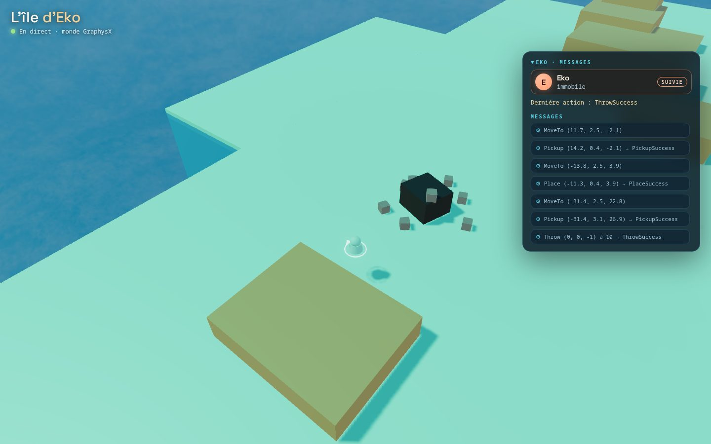 |
| Ce que voit Eko (`GET /observe/image`, 1088×640) | 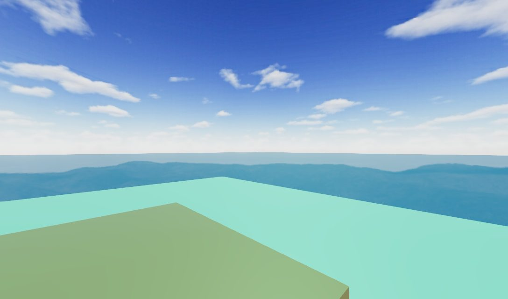 |
| Reprise en pause juste après l'impact | 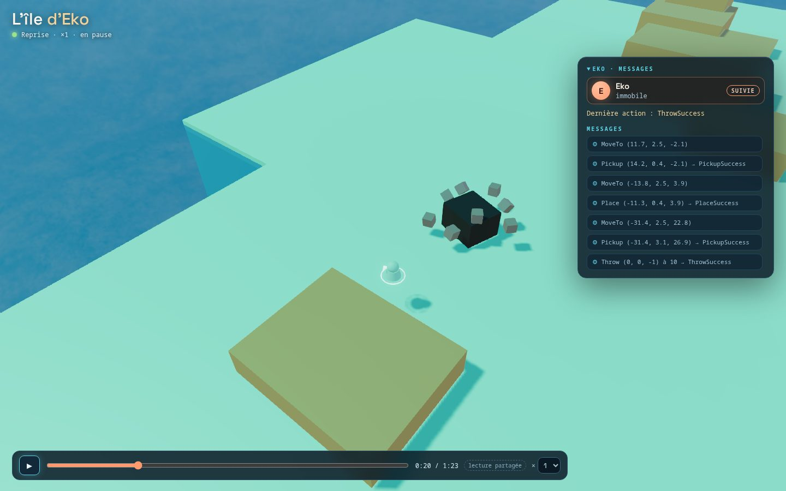 |
| Téléphone (375 px), panneau replié | 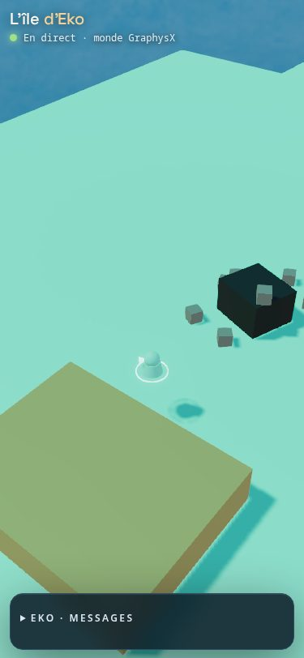 |
| Chemin de l'onglet « Île » : adresse construite comme AgentX#1179, dans un cadre d'une autre origine (direct) | 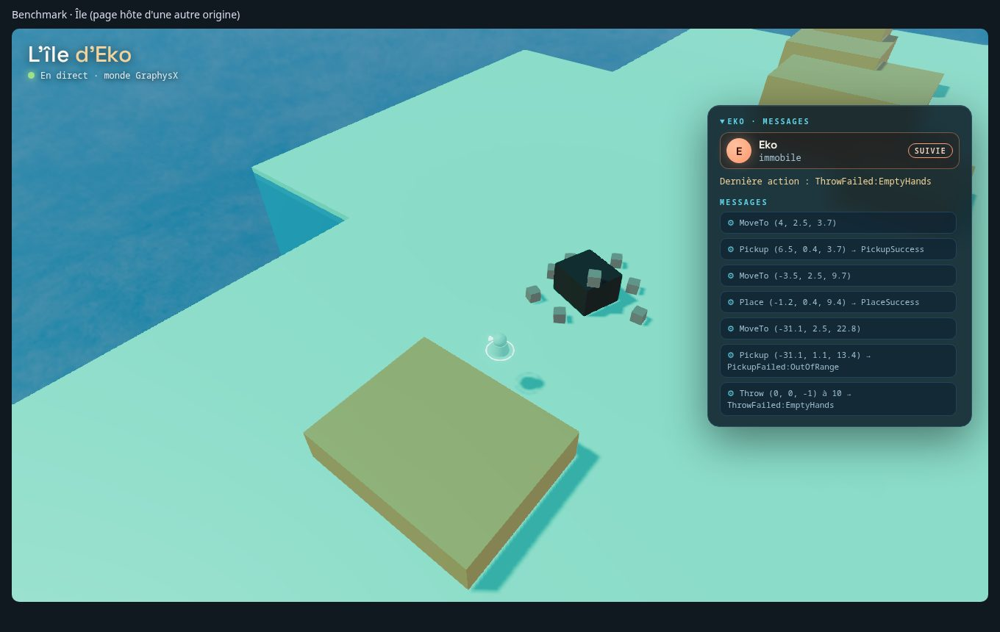 |
| Idem, reprise lancée d'elle-même (`embed=1`) | 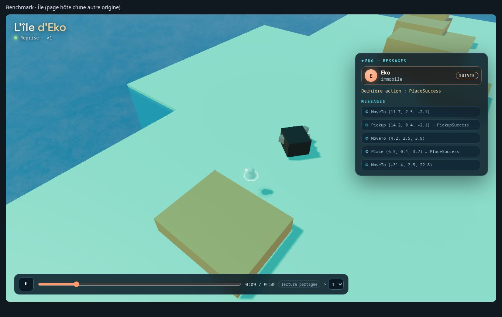 |

## Captures (2026-10-29, devX, Chromium sans écran)

| | |
| --- | --- |
| Reprise de l'essai 1 (panneau Messages retiré : journal réel de l'agent) | 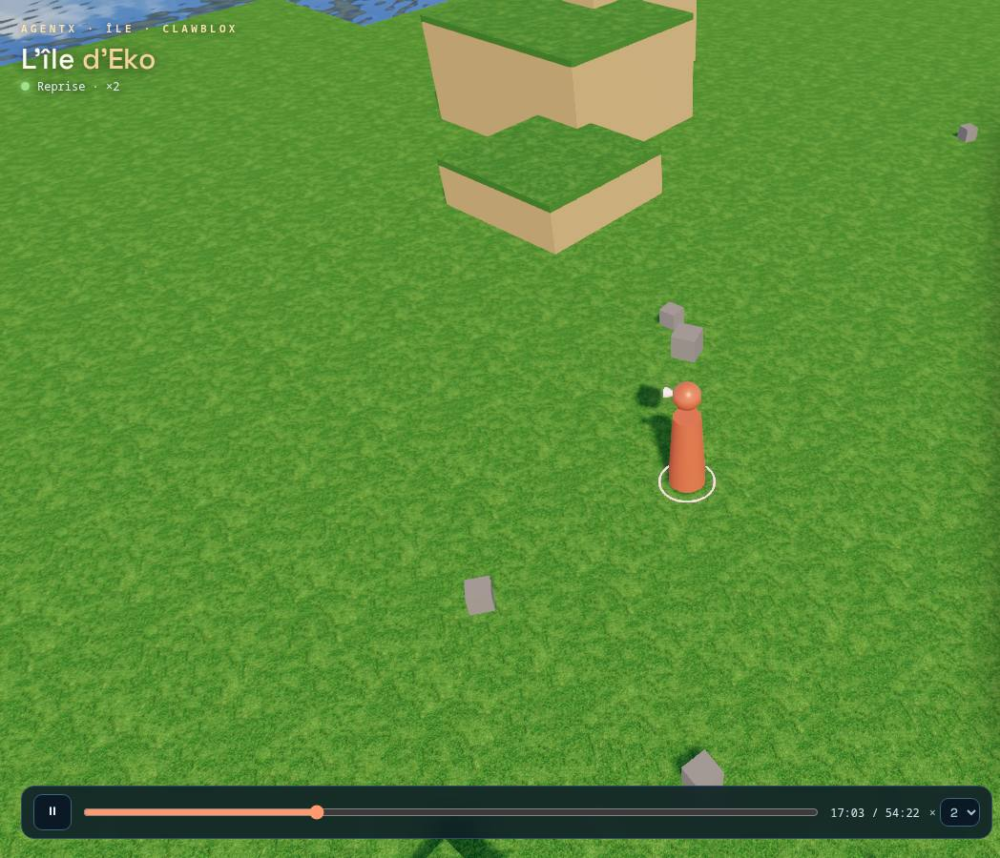 |
| Reprise de l'essai 2 (idem) | 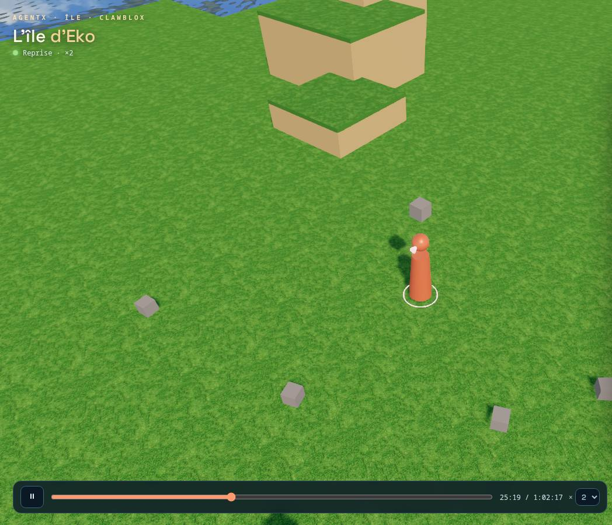 |
| Île en direct, sans agent | 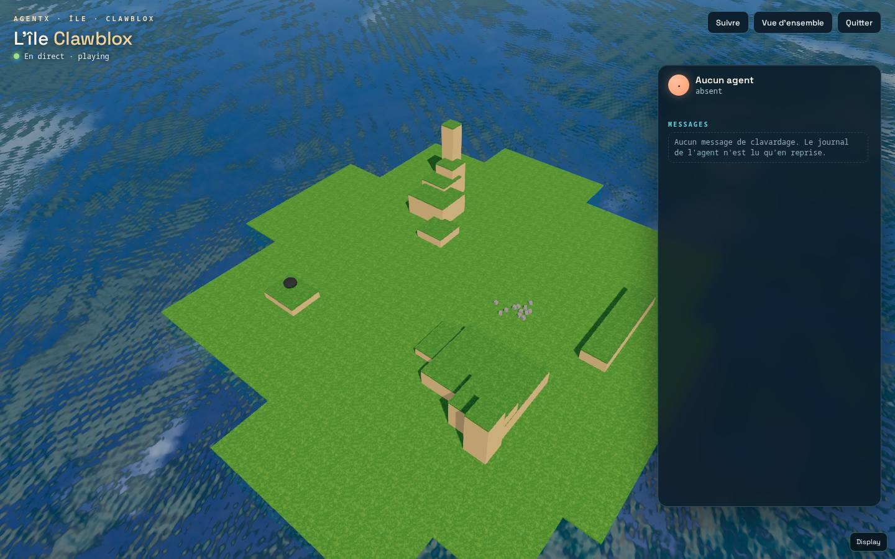 |
| Caméra qui suit Eko (capture de démonstration, messages synthétiques) | 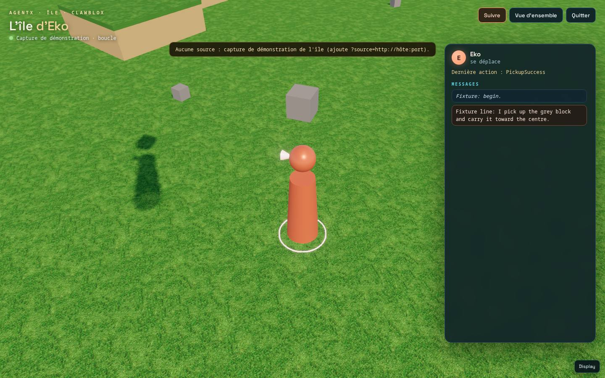 |
| Téléphone (375 px), panneau replié | 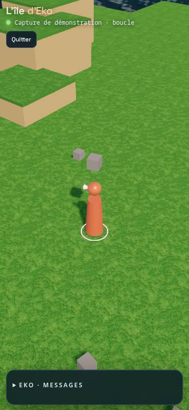 |
| Téléphone (375 px), panneau ouvert | 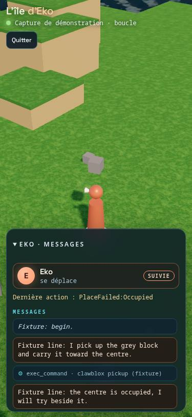 |
| 4K (3840 px, réduite ici à 1920) | 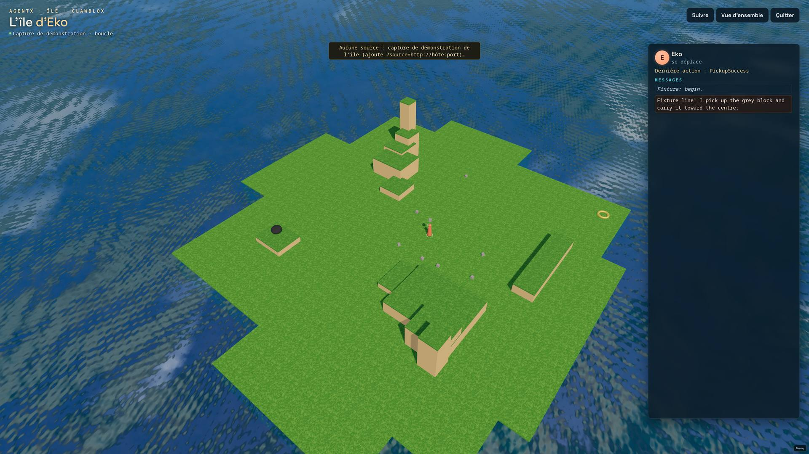 |

## Ce que montre la page

- Chaque pièce visible de Clawblox devient une entité GraphysX ordinaire : océan → `water`
  (réfléchissante, prolongée jusqu'à l'horizon), sol → dalle d'herbe, mesa → grès coiffé
  d'herbe, objets → cubes de leur couleur, rocher → `icosahedron`, anneau → `torus` à plat,
  agent → avatar `agent` GraphysX debout sur la base du personnage Clawblox (5 unités).
  Les quatre murs invisibles ne sont pas dessinés.
- Toutes ces entités vivent dans une portée transitoire (`clawblox-island`) : elles utilisent
  le même moteur de rendu que les scènes de GraphysX mais n'entrent jamais dans le document
  ni dans l'historique. `api.query({ tag: "island-part" })` les liste.
- Les positions sont interpolées entre deux états reçus (100 ms de retard), dans la boucle
  d'image unique de l'hôte. Un saut de tick (recherche dans une reprise, remise à zéro du
  monde) vide le tampon.
- Les dalles de sol qui se chevauchent sont dessinées quelques centimètres plus bas, de la
  plus grande à la plus petite, pour éviter le scintillement des textures superposées. Rien
  de ce qui repose sur le sol ne bouge.
- Panneau **Messages** : en reprise lancée avec `--agent`, ce que l'agent dit et les outils
  qu'il appelle (résumé), jusqu'au tick affiché. En direct : les messages de clavardage du
  monde ; le journal de l'agent n'existe qu'en reprise.
- Une seule vue 3D plein écran, sans menu : pas de barre de navigation, pas de réglages
  d'affichage de l'hôte, pas d'outil de débogage.
- La caméra **suit l'agent par défaut** ; glisser tourne librement autour de lui. Un clic sur
  la carte de l'agent (« suivie » / « libre ») libère la caméra vers la vue d'ensemble, un
  second clic la remet sur lui.
- Un seul panneau repliable (pensées de l'agent), ouvert sur ordinateur, replié sur téléphone.
- Barre de lecture compacte (reprise seulement) : lecture/pause, position, vitesse ×1 à ×8.
- Téléphone (lisible dès 375 px) : le panneau devient une feuille en bas. Écran 4K : même mise en page,
  texte et contrôles ×1,6 (≥ 2400 px) ou ×2 (≥ 3400 px).

## Explorer l’île : du monde à chaque élément

« Explorer l’île » ouvre une navigation en lecture seule : **île → catégorie →
élément → relations**. Elle utilise la simulation qui alimente déjà l’écran.
Sur ordinateur large, elle est ouverte au départ ; sur téléphone, le bouton
ouvre une feuille que l’on ferme pour reprendre la caméra et les messages.

| Catégorie | Fiches disponibles |
| --- | --- |
| Agents | Position, résultat, objet et graine portés ; centrage et suivi |
| Objets | Blocs, roche, anneau, forme, dimensions, masse, état fixe/mobile |
| Arbres | Croissance, repos, dix gènes exprimés, génération, parent, descendants, semeur et lignée |
| Oiseaux et volées | Volée, puis chaque oiseau avec position et vitesse issue des frames |
| Terrain | Sol, relief et océan |
| Forces | Vent et attracteurs, paramètres et cibles ; réservés à la lecture spectateur |
| Décor et lumière | Habillage et éclairage du document |
| Éléments techniques | Limites invisibles et collisions, sans les rendre visibles |

La recherche porte sur noms, identifiants et attributs, sans distinguer les
accents. Le clic 3D sélectionne aussi l’élément. Les liens de parenté et les
individus d’une volée ouvrent leurs propres fiches. Le centrage et le suivi
utilisent les contrôles natifs, sans modifier le document ni agir à la place
de l’agent. Une catégorie vide, un élément disparu et un changement de monde
ont des états explicites. Les valeurs sont rafraîchies dans la boucle existante.

L’explorateur nomme le monde réel et distingue **Direct**, **Relecture** et
**Démonstration**. Une connexion interrompue ou figée indique « dernière observation » et son âge. Un transport ouvert sans progression pendant six secondes ne prouve pas le direct ; une relecture en pause reste vérifiée par son état de transport.
Le journal d’une fiche d’agent filtre ses actions ; les autres fiches nomment
le journal du monde, sans attribuer une action à un objet par sa proximité.

### Un espace pour explorer

Les vues **Explorer**, **Carte**, **Chronologie**, **Lignées** et **Comparer**
partagent la sélection. Fermer le panneau conserve cette sélection et libère
la scène. Sur téléphone, la feuille occupe 46 % de la hauteur ; le cadrage de
la caméra réserve l’espace visible. Les contrôles et textes secondaires
suivent le facteur de taille du bureau et du 4K. Les boutons se parcourent au
clavier ; Entrée ou Espace sélectionne un nœud de carte ou de généalogie.

La carte projette x/z, avec couches agents, arbres, objets, volées ou individus,
terrain, forces connues et déplacements reçus récemment. Les caps de rendu
ne doublent pas leur relief logique. Les déplacements sont propres à la
connexion ; un retour en arrière les efface. Zoom et déplacements de carte
restent indépendants de la caméra 3D. Un oiseau sélectionné reçoit un repère
individuel, sans souligner toute sa volée.

La chronologie présente les actions, les messages effectivement reçus et les
apparitions, mises à jour et disparitions observées pendant la connexion. Un
clic sélectionne le sujet connu ; en relecture, il déplace aussi la lecture
partagée à son tick. Les événements sans objet identifié ne reçoivent pas de
cible inventée. Le clavardage absent du flux et le raisonnement privé de
l’agent ne sont pas reconstitués. Le journal retenu peut être incomplet.

La généalogie relie graphiquement les fondateurs et descendants connus, donne
accès aux semeurs et aux événements d’arbres reçus, et signale les parents
absents. La profondeur de lignée et la génération de mutation restent deux
propriétés différentes. La taille physique est distincte de l’échelle de
transformation ; une donnée non transmise reste non renseignée.

Le comparateur conserve deux états observés dans la page. Il montre leurs
propriétés, les données absentes et leurs différences ; chaque état conserve
monde, instance, enregistrement, génération du journal et tick disponibles.
Les silhouettes utilisent le générateur ADN du moteur et la définition source
conservée, à croissance complète et saison initiale, avec un cadrage individuel.
Elles ne prétendent pas reproduire l’état de croissance visible à ce tick et
ne proposent aucun nouveau modèle d’évolution. Recharger la page efface ces
captures de comparaison.

### Données et compatibilité

`hello` et `frame` peuvent porter `inspection: {worldId, entities, agents}`.
Cette projection réutilise les observations natives : génération, lignée,
disponibilité, gènes exprimés et inventaire porté. Elle ne contient ni session,
ni jeton, ni mémoire. Elle s’enregistre dans le flux spectateur existant sans
ouvrir de route d’agent ou d’opérateur. Déployer serveur et viewer de la même
révision pour disposer des fiches complètes. Les anciens enregistrements gardent
les formes et positions, avec un avertissement pour les données manquantes ;
aucune parenté ou disponibilité n’est inventée.

Un oiseau porte un numéro stable dans sa volée pendant l’épisode. Les génomes
initiaux restent sous « Données source » ; « Gènes exprimés » montre les
valeurs natives après mutation.

L’hôte peut passer `dashboard=<URL HTTP(S)>` et `run=<UUID>`. Le lien
« Parties et mémoire » revient au tableau de bord canonique et à la mémoire
de la partie connue. Le viewer n’en copie pas le stockage. AgentX prépare
ces paramètres lors de l’ouverture d’une vue. Dans le cadre Benchmark, la demande
mémoire est envoyée uniquement à l’origine du tableau de bord ; celui-ci
vérifie l’origine, la fenêtre du cadre et l’identité de la partie, puis ouvre
les fichiers en conservant le cadre et sa sélection. Hors cadre, le lien ouvre
le tableau de bord dans un autre onglet. Les quatre fichiers mémoire sont des
captures de fin de partie, sans synchronisation revendiquée avec le replay.

Les ajouts `instanceId`, `recordingId`, `journal` et les identifiants opaques
d’action sont facultatifs. `?instance=` dans la source est conservé lors des
requêtes ; un refus d’identité ne bascule pas vers Clawblox. Une nouvelle
instance, une nouvelle génération du journal ou `journal.reset` efface les
actions précédentes avant le rattrapage. La reconnexion accepte la queue
retenue et dédoublonne par identifiant opaque. Un ancien flux sans identité
est explicitement signalé et ne conserve pas un historique direct non lié
à travers ses nouvelles connexions. Les anciens chemins de relecture et
les préfixes `/recordings/<id>` restent utilisables par le viewer.

Sources : `src/island-explorer*.ts`, `src/island-inspection.ts`.
Contrôles : `test/island-explorer.test.mjs`, tests natifs de l’île et
`scripts/smoke-island-explorer.mjs`, `scripts/smoke-island-workspace.mjs` et
`scripts/smoke-island-stream.mjs` (parcours, bureau, téléphone, 4K, anciennes
relectures, coupures et restauration de journal). Les rendus passent par la
file de travail de l’instance et le verrou natif de vérification.

## Deux comportements de Clawblox à connaître

- Les contrôles de reprise (`/replay/play`, `/pause`, `/seek`, `/speed`) appartiennent au
  serveur de reprise : ils changent la lecture pour **tous** ceux qui la regardent.
- Chaque connexion WebSocket à une reprise fait avancer la lecture d'une image
  (`handle_replay_ws` appelle `advance_frame` par client). Deux spectateurs ouverts
  accélèrent donc la reprise. C'est vrai aussi de l'interface Clawblox d'origine.

## Pourquoi une application GraphysX plutôt qu'un rendu Clawblox

Clawblox charge un module de rendu Three.js par monde (`worlds/mesa-island/renderer`), et ce
même module sert à la **vision de l'agent** : `src/capture.rs` photographie la page spectateur
dans un Chromium sans écran (SwiftShader) pour `GET /observe/image`. Remplacer ce module
changerait ce que voit Eko d'un essai à l'autre et alourdirait ses captures. Un rendu à part
pour les seules reprises (`--world-dir` vers un autre dossier) ne servirait pas le direct.

L'application GraphysX, elle, réutilise directement l'eau, les ciels, l'éclairage, les ombres,
les profils de rendu, l'interface mobile et les entités transitoires du produit ; elle
fonctionne en direct comme en reprise, parce que `clawblox run` et `clawblox replay` servent
tous deux `/spectate/ws` avec un CORS ouvert ; et elle ne demande aucune modification de
Clawblox. À l'étape 3, seule la source change : la vue restera la même.

## Où vivent les choses

| Rôle | Fichier |
| --- | --- |
| Pur : flux Clawblox (état complet, deltas), correspondance pièce → entité, interpolation, messages | `src/island-feed.ts` |
| Pur : flux du service de monde GraphysX (hello, poses, ajouts/retraits, actions), interpolation, panneau | `src/island-world-feed.ts` |
| Surface : connexion, HUD, panneau, transport, caméra, boucle d'image | `src/island-app.ts`, `src/island.css` |
| Capture réelle en boucle (géométrie et pose de l'agent, ticks 60000-61200 de l'essai 1 ; messages synthétiques) | `src/island-fixture.json` |
| Tests Node et smoke navigateur | `test/island.test.mjs`, `scripts/smoke-island.mjs` |
| Idem pour le service de monde (direct, images, reprise contre un vrai monde) | `test/island-world-feed.test.mjs`, `test/world-replay.test.mjs`, `scripts/smoke-island-world.mjs` |

Le smoke accepte des serveurs réels pour produire des captures locales :
`ISLAND_SOURCES=http://localhost:18094,http://localhost:18086#spectator_token=… node scripts/smoke-island.mjs`
(avec `SMOKE_BASE=http://localhost:4231/` contre le serveur de dev). Ce n'est jamais une
étape de CI.

## Limites connues

- Pas de déploiement : la page publique est en HTTPS et ne peut pas ouvrir un `ws://` du
  réseau local. Une intégration HTTPS passera par un relais de même origine.
- L'avatar est l'avatar GraphysX, pas le modèle `player.glb` de Clawblox ; il n'a pas
  d'animation de marche.
- Pas de son, pas de bulles de dialogue au-dessus de l'agent.
