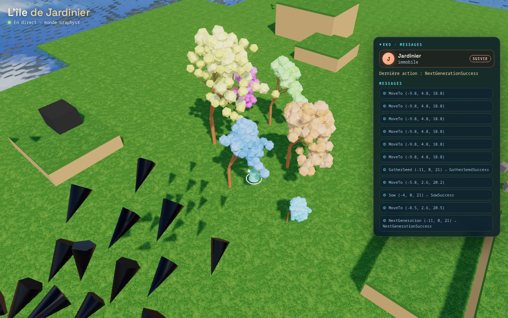
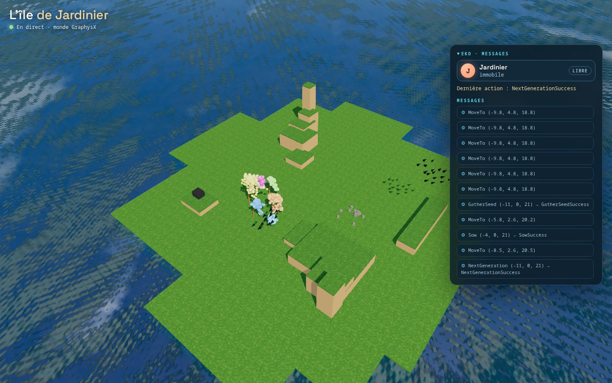
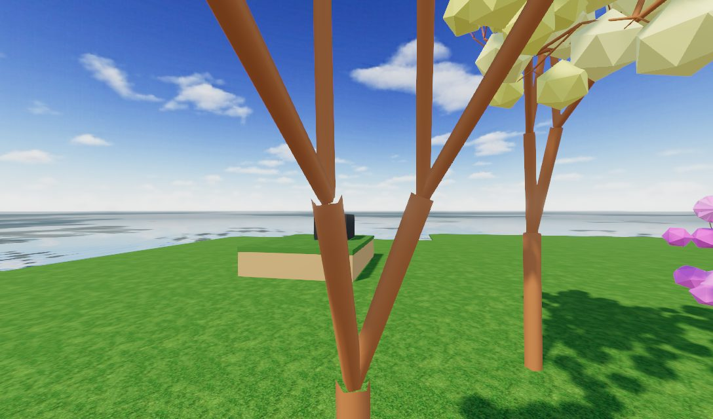
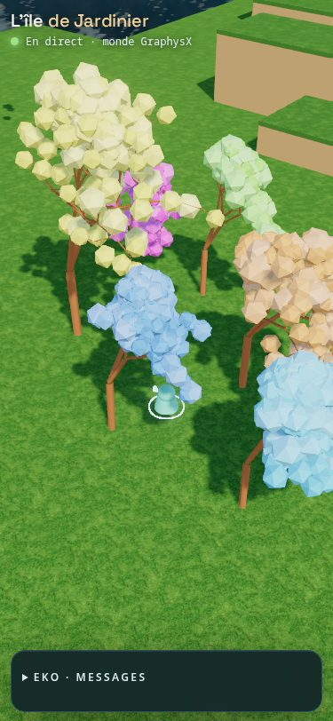
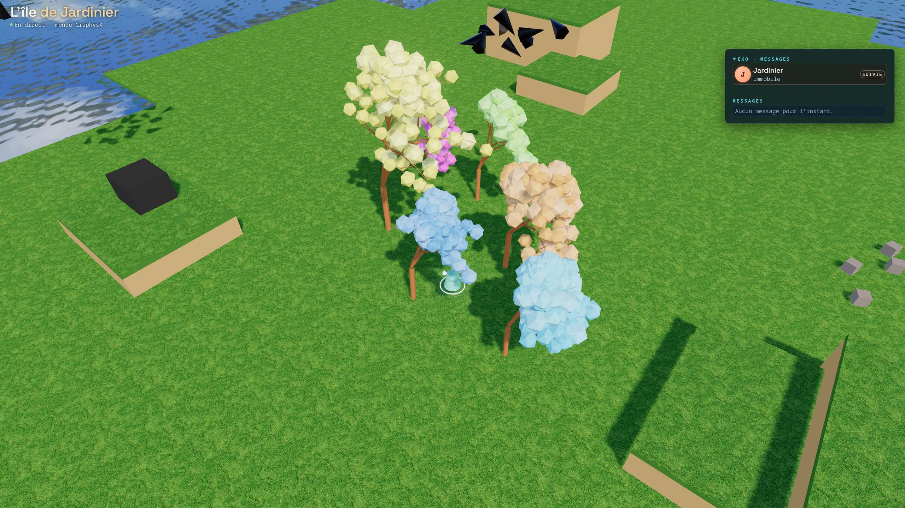
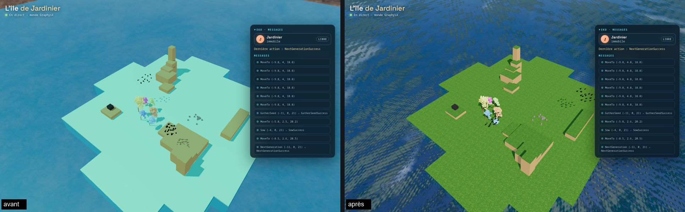
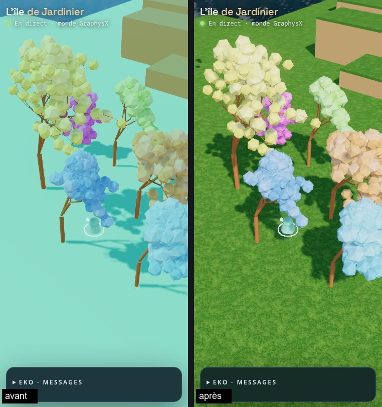

# L'île vivante (chantier D)

Rédigé le 2026-10-29 vers 19:30 America/Toronto, complété vers 22:30 (sélecteur de monde,
troncs solides) après les réponses de Yanik. Rien n'est déployé, aucun modèle n'a été
appelé, le MCP GraphysX reste éteint. Code : `world-service/living-island.ts`, lancé avec
`--world living-island` (ou `WORLD_ID=living-island`). L'île vivante ne change rien à Mesa :
mêmes corps, mêmes règles. Les deux îles partagent depuis le 2026-10-29 au soir le décor de
l'île Clawblox (section « Le décor »).

## Pourquoi

Sur l'île Mesa, Eko a 12 blocs, une roche et un anneau. L'hypothèse de Yanik : un jeu naît
d'un monde qui surprend. L'île vivante ajoute ce qui pousse, ce qui bouge seul et ce qui
pousse les objets, avec du code que GraphysX avait déjà, sans fonction de score.

## L'idée centrale : ce sont les agents qui sélectionnent

La Forêt vivante de GraphysX (`src/agent-world-dna.ts`, reprise des esquisses Nature of Code de
SBQC) fait pousser chaque arbre à partir d'une graine et d'un génome, sans hasard caché : la même
graine donne toujours le même arbre. Une génération fait dériver un peu les gènes. Il n'y a
**aucune fonction de fitness** : dans l'archive, c'est un humain qui appuyait sur « Génération
suivante ».

Sur l'île vivante, ce geste passe à l'agent :

```
        observe les arbres (gènes, couleur, lignée)
                     │
     goût de l'agent │  « celui-là me plaît »
                     ▼
  ┌──────────┐  GatherSeed  ┌──────────┐    Sow     ┌──────────────┐
  │ Tree_4   │─────────────►│  graine  │───────────►│ Tree_6       │
  │ gén. 1   │              │ (poche)  │            │ gènes de     │
  └────┬─────┘              └──────────┘            │ Tree_4, gén 1│
       │ NextGeneration                             └──────┬───────┘
       ▼                                                   │ 30 s pour pousser
  ┌──────────┐                                             ▼
  │ Tree_4   │   les gènes dérivent ; l'arbre        GatherSeed, Sow…
  │ gén. 2   │   se repose 30 s                      Tree_4 > Tree_6 > Tree_9
  └──────────┘
```

Une lignée ne continue que si un agent en garde une graine et la sème. Son goût devient la
seule pression de sélection. C'est de l'**auto-télie**, un des signes de jeu de l'article MIT
« Is this machine playing? » : le but vient de l'agent, pas du monde.

## Ce que le code existant donne

| Module | Ce qu'il fait | Sur l'île vivante |
|---|---|---|
| `agent-world-dna.ts` | arbres `dna-tree` déterministes ; génome de 10 gènes (tronc, ratio, angle, rotation, profondeur, ramification, teinte…) ; mutation cumulative par génération | **utilisé** : 5 fondateurs, un arbre par entité ; les gènes sont lus dans l'observation |
| `agent-world-flock.ts` | volée de Reynolds (séparation, alignement, cohésion) ; poussée par les champs de force | **utilisé** : 28 oiseaux ; ajout d'un point d'accès `hostAcceleration` (peur des agents et des blocs lancés) et `readMembers` / `writeMembers` (reprise exacte, vue) |
| `agent-world-force-field.ts` | attracteur, flux, traînée, tourbillon ; agit sur les corps, volées et particules | **utilisé** : un vent (flux) invisible et un « perchoir » (attracteur doux) au-dessus de chaque arbre |
| `agent-world-crowd.ts` | foule au sol, errants et poursuivants, conversion par contact | **pas encore** : son départ utilise `Math.random()`, ce qui casserait la reprise exacte |
| `agent-world-formula.ts` | champ de molécules réglé par une formule (A, B, C, M, X) | **pas encore** : une bonne « zone qui transforme » (voir plus bas) |
| `world-recipes.ts` | recettes d'études (`living-forest`, `forces-garden`, `flock-planet`) : graine et réglages | modèle pour des variantes d'île (saison, vent fort) |
| `ecosystem-scene.ts` | un monde composé de primitives, chaque objet retrouvable par étiquette | même principe : arbres, perchoirs et vent sont des entités v2 étiquetées `living` |

## Ce qui est construit

| Élément | Où | Règle |
|---|---|---|
| Forêt | 5 fondateurs `Tree_1` à `Tree_5` au nord-ouest du départ, chacun un génome différent (vert, orange, jaune, bleu, rose) ; jusqu'à 24 arbres | un arbre semé pousse en 3 tailles (0, 15, 30 s) puis est prêt |
| Troncs | un cylindre invisible et statique par arbre (rayon 0,35, haut comme le premier segment), reconstruit quand l'arbre grandit ou change de génération | on bute contre le tronc, on traverse branches et feuilles ; pas de semis là où quelqu'un se tient (`SowFailed:Occupied`) |
| `GatherSeed {position}` | racine d'un arbre prêt, à 6 unités | une graine dans la poche (`HeldSeed: "Tree_4@1"`) ; une nouvelle remplace l'ancienne |
| `Sow {position}` | sol libre à 7 unités, à 4 unités des autres arbres, hors des mesas | nouvel arbre avec les gènes exprimés du parent, nouvelle graine, génération 1 |
| `NextGeneration {position}` | arbre prêt à 6 unités | génération +1 (gènes qui dérivent), puis 30 s de repos |
| Volée `Flock_1` | 28 oiseaux entre y = 12 et 18 | fuient un agent à moins de 14 unités et un bloc lancé (vitesse ≥ 5) à moins de 8 ; attirés par les arbres |
| Vent | boîte au sud-est (x 2 à 42, z −42 à −2) | pousse les corps en vol et les oiseaux ; pas Eko, ni un bloc posé (mesuré : immobile 20 s) ; **absent** de l'observation et de `/api.md` |

L'observation garde la forme Clawblox : chaque arbre est une entité `shape: "Tree"` avec ses
attributs (`Generation`, `Ready`, `ReadyIn`, `Parent`, `Lineage`, `SownBy`, `LeafColor`,
`Height`, `Branches`, les gènes) ; la volée donne `Members`, `Spread`, `MeanSpeed`, `Startled`.
`/api.md` décrit les trois actions sans proposer de but. Le flux `/spectate` ajoute `swarms`
(les 28 oiseaux, 10 fois par seconde) ; un arbre qui change est renvoyé sous le même
identifiant et la vue le reconstruit. La reprise (`/snapshot`, `--resume`) garde arbres, graines
et chaque oiseau au bit près.

Coût mesuré sur devX (Ryzen 7 3700X) : 0,20 ms par pas avec 1 agent (Mesa : 0,13), 0,27 ms
avec 8 ; image spectateur 1,2 Ko (Mesa : 0,7) ; sauvegarde 101 Ko (Mesa : 84).

## Captures (2026-10-29, devX, Chromium sans écran)

Le jardinier scripté vient de garder une graine de `Tree_4` (le plus touffu), de la semer
(`Tree_6`, le petit arbre bleu) et de faire avancer `Tree_4` d'une génération.

| | |
| --- | --- |
| Bureau, caméra sur le jardinier |  |
| Vue d'ensemble : la forêt et la volée (les oiseaux évitent l'agent suivi) |  |
| Ce que voit le jardinier (`GET /observe/image`, 1088×640) |  |
| Téléphone (375 px), panneau replié |  |
| 4K (3840×2160, HUD à l'échelle 2 ; image réduite à 2560 px), `Tree_6` adulte |  |

## Le décor

Remarque du 2026-10-29 au soir : dans la vue, le sol des îles du service sortait menthe et uni,
loin de l'île Clawblox vue dans la même page. La vue habille une île Clawblox (herbe texturée,
chapeau d'herbe sur chaque mesa, mer réfléchissante, `src/island-feed.ts`) ; une île du service
s'affiche depuis son propre document, qui n'avait que des boîtes de couleur.

Le document de Mesa (donc aussi celui de l'île vivante) porte maintenant le même habillage,
en **décor sans physique** : les dalles de sol gardent leurs corps mais sont cachées sous une
dalle d'herbe ; chaque mesa reçoit son chapeau d'herbe ; l'océan reste une dalle cachée sous une
surface d'eau ; les lampes sont celles de la vue (ambiante 0,55 bleutée, soleil 2,6 chaud).
Les corps, les règles et l'observation ne changent pas (même position de l'océan, mêmes noms,
mêmes couleurs annoncées). L'empreinte de Mesa change (`3bdeced47efb7c86`) : les sauvegardes
d'avant sont refusées ; aucune n'est en service. La vue à la première personne d'Eko voit le
même décor.

| | |
| --- | --- |
| Vue d'ensemble, avant et après |  |
| Téléphone (375 px), avant et après |  |

## Choisir le monde : un seul conteneur, un sélecteur

Décision de Yanik (2026-10-29) : tout dans le même conteneur, avec un sélecteur. Le service
démarre sur `WORLD_ID` (Mesa par défaut) et l'opérateur change d'île sans redémarrer :

```bash
curl -X POST -H "X-Operator-Token: $WORLD_OPERATOR_TOKEN" -H "content-type: application/json"   -d '{"world": "living-island"}' http://127.0.0.1:18120/world
```

- La route est réservée à l'opérateur (jeton), comme `/snapshot`. Les agents ne peuvent pas
  changer de monde.
- Elle refuse (409) tant qu'un agent est sur l'île, sauf avec `"force": true` : ses sessions
  se terminent avec l'ancienne île.
- Les spectateurs reçoivent le nouveau document (la vue `?app=island` suit sans recharger).
  `/healthz` dit le monde en cours (`{ok, tick, world}`) et `/api.md` suit le monde.
- Chaque changement ouvre un nouvel enregistrement à côté du premier
  (`<dossier>-1-living-island`, `<dossier>-2-mesa-island`…), pour qu'une reprise reste une
  seule ligne de temps.
- Pas encore fait : le bouton dans Benchmark ou la file de Core. Le runner d'AgentX choisira le
  monde avant de lancer une partie.

## Garanties conservées

- Rien de nouveau côté réseau : mêmes routes, mêmes jetons, `/snapshot` réservé à l'opérateur.
  Les actions vivantes passent par `POST /input` comme les autres.
- Aucune information cachée n'est donnée à l'agent : il voit ce qu'un joueur verrait (arbres,
  oiseaux), pas le vent ni les perchoirs.
- Aucun appel de modèle. La simulation reste déterministe (pas de `Math.random()`).

## Volées, foules et champs : la suite possible

- **Blocs lancés** : déjà fait, un bloc rapide disperse les oiseaux. On pourrait ajouter : un
  oiseau touché se pose, ou la volée suit un agent immobile longtemps.
- **Courants** : un tourbillon (`vortex`) au-dessus de l'océan qui ramène les blocs tombés.
- **Zones qui transforment** : un bloc laissé dans un anneau devient une graine, ou la teinte
  d'un arbre suit la formule d'un champ voisin (`formula-field`).
- **Foules** : de petits animaux qui errent et s'enfuient, une fois `agent-world-crowd.ts`
  rendu déterministe (graine au lieu de `Math.random()`).

## Ce qu'on mesurerait

Tout vient de l'enregistrement (`--record` : actions avec résultat, arbres semés, images) et
des fichiers de mémoire d'Eko.

| Question | Mesure |
|---|---|
| Joue-t-il avec la forêt ? | nombre de `GatherSeed`, `Sow`, `NextGeneration` par heure, sans demande ni récompense |
| A-t-il un goût stable ? | direction des gènes choisis au fil des générations, comparée à une marche au hasard (même nombre de choix, arbres tirés au sort) |
| Invente-t-il des règles ? | motifs dans les semis (ligne, cercle, couleurs groupées) ; règles écrites dans sa mémoire ou le clavardage (« je ne garde que les bleus ») puis suivies |
| Joue-t-il avec les oiseaux ? | approches répétées de la volée, lancers vers elle, montées sur le Peak |
| Découvre-t-il le vent ? | lancers répétés dans la zone, mention de la dérive dans sa mémoire |
| Revient-il ? | reprise des mêmes lignées d'une partie à l'autre ; aujourd'hui seule la mémoire passe, garder la forêt entre deux parties serait une décision à part |

## Essayer (devX, sans modèle)

```bash
npm run build:world-service
npm run serve:world -- --world living-island --port 18160 --record --record-dir /tmp/ile-vivante
node world-service/gardener.mjs --base http://127.0.0.1:18160 --taste warm --wait-sapling
npx vite --port 18163   # puis /?app=island&source=http://127.0.0.1:18160&agent=Jardinier
node --test test/living-island.test.mjs
node scripts/smoke-living-island.mjs   # après npm run build
```

Le jardinier (`world-service/gardener.mjs`) est un agent scripté : il choisit un arbre selon un
goût fixe (`bushy`, `tall` ou `warm`), en garde une graine, la sème, puis fait avancer le parent.

## Limites

- Seuls les troncs sont solides ; branches et feuilles se traversent.
- La vue 4K n'est pas dans le parcours automatique : en WebGL logiciel, toute page du service
  de monde met environ 48 s à afficher ses premières images en 3840×2160, avec ou sans la
  forêt (mesuré le 2026-10-29). La capture 4K de la PR a été faite à part.
- Pour qu'Eko joue ici, il manque le côté AgentX (voir la PR) : le runner doit se joindre à un
  monde déjà en marche, et le relais des vues doit laisser passer `/healthz` et `/spectate`.
