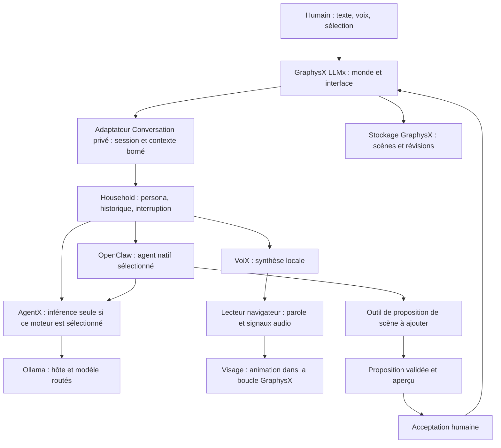

# LLMx — plan de réalisation

Date : 2026-09-13. Statut : plan proposé, aucune fonctionnalité LLMx implémentée par ce document.

**Résultat recherché :** entrer dans un environnement 3D persistant, voir un visage de cubes se construire dans une ambiance gothique industrielle, puis entendre le même interlocuteur que dans nos conversations AgentX ouvrir l'échange par « Hello ». On peut ensuite lui parler, construire avec lui, annuler une modification et retrouver son monde à la prochaine visite.

Ce plan porte sur le code local inspecté, pas sur une vérification de production. Aucun appel au homelab ni changement de modèle, de GPU ou de déploiement n'a été effectué. Les valeurs graphiques et temporelles proposées sont des points de départ à mesurer.

## 1. Décisions proposées

| Sujet | Décision |
| --- | --- |
| Entrée | Ajouter **LLMx** parmi les entrées GraphysX, route proposée `?app=llmx`. Conserver le showroom comme accueil général. |
| Premier monde | **Forge nocturne**, modèle livré avec le produit, cloné dans un environnement personnel au premier usage. |
| Navigation | LLMx → Reprendre / Mes environnements → Charger. Un clic pour reprendre le dernier monde. |
| Interlocuteur | Réutiliser la persona, la session, le moteur et la voix sélectionnés dans notre infrastructure Conversation. Nestor constitue le choix initial proposé. |
| Visage | Une apparence `voxel-face` d'une entité `agent`, sérialisable, avec un rendu de cubes groupés et des expressions animées localement. |
| Accueil | Un véritable tour initié par l'application au nom de l'agent, commençant par « Hello », exécuté dans la session existante et enregistré comme accueil de l'assistant. |
| Création | Contexte spatial → proposition validée → aperçu → acceptation → application avec reçu et annulation. |
| Infrastructure | GraphysX possède le monde; Household possède la conversation privée; OpenClaw exécute l'agent natif lorsque sélectionné; AgentX route l'inférence; VoiX produit et joue la voix via son lecteur partagé. |
| Dépendances | Objectif : aucune nouvelle dépendance JavaScript de production pour la V1. De nouveaux assets artistiques et quelques extensions des contrats existants sont nécessaires. |
| Livraison initiale | Application et raccord Conversation privés en HTTPS sur le LAN. Les endpoints et secrets privés ne sont pas publiés avec la distribution publique GraphysX. |

Les documents actuels reportaient la composition d'applications jusqu'à l'arrivée d'une seconde application réelle. LLMx fournit ce cas concret. Le présent besoin justifie une petite généralisation de l'entrée `?app=`, sans extraction de paquet npm ni refonte générale du Center. La priorité KidX existante reste documentée; ce plan constitue une nouvelle piste explicitement demandée par Yanik.

## 2. Ce que nous avons réellement

Révisions de référence inspectées : GraphysX `60aaa5b`, travail vocal KidX `e9cbbd5`, AIOps `976e3b21`, AgentX-Ecosystem `eb11846`. Ces références décrivent les checkouts consultés, pas les versions servies.

| Brique | État constaté et point d'entrée | Travail LLMx |
| --- | --- | --- |
| Application sur le moteur partagé | [`main.ts`](../src/main.ts), `openApplication()` est actuellement spécialisé `ev3-lab`; `PlatformHost.subscribeFrame()` existe | Petit contrat commun de montage, état, sortie et destruction; ajouter LLMx avec import différé |
| Monde éditable et sauvegardable | [`agent-world-runtime.ts`](../src/agent-world-runtime.ts), format `graphysx.agent-world/v2`, éditeur et API partagés | Ajouter l'apparence du visage et les métadonnées publiques nécessaires à la reprise |
| Sauvegarde distante | [`scene-store-client.ts`](../src/scene-store-client.ts), [`scene-browser.ts`](../src/scene-browser.ts), [`scene-store.mjs`](../server/scene-store.mjs), révisions et écritures atomiques | Composer la bibliothèque LLMx, la sauvegarde automatique et la gestion des conflits |
| Éclairage et ambiance | [`platform-host.ts`](../src/platform-host.ts), ACES, ombres, HDRI, brume, bloom, SMAA, mouvement d'entrée | Créer un look cohérent; éviter de monter une deuxième pile de rendu |
| Particules | [`agent-world-particles.ts`](../src/agent-world-particles.ts), huit presets, graines, rampes couleur/taille, maximum de 600 particules par émetteur | Retuner des instances existantes, coordonner leurs réactions et poser un budget global |
| Cubes groupés | [`agent-world-formula.ts`](../src/agent-world-formula.ts), ainsi que flock/crowd/DNA | Réutiliser la technique de rendu; construire une géométrie et une animation de visage propres |
| Présence dans le monde | [`live-agent-presence.ts`](../src/live-agent-presence.ts), projections temporaires dans la boucle du host | Réutiliser le principe; la présence d'une conversation n'est pas automatiquement une inscription à une session multijoueur |
| Modifications par un fournisseur | [`coauthor-provider.ts`](../src/coauthor-provider.ts), propositions structurées, 40 commandes maximum, aucun fournisseur actif par défaut | Relier les propositions à une conversation et à la bonne révision de scène |
| Conversation privée | AIOps [`CONVERSATION.md`](../../aiOPs/adapters/household/CONVERSATION.md), sessions, persona, historique, interruption, moteur natif ou AgentX | Fournir un consommateur LLMx privé et un accueil initié par l'agent |
| Projection de persona | AIOps [`conversation-page.js`](../../aiOPs/adapters/household/public/conversation-page.js), événement `persona-presence` | Extraire une notification réutilisable; cet événement DOM local ne traverse pas les applications tout seul |
| Voix navigateur | AIOps [`browser-conversation.js`](../../aiOPs/adapters/household/public/browser-conversation.js), VoiX [`voice-audio.js`](../../VoiX/app/web/voice-audio.js), lecteur PCM progressif, destinations audio et métriques | Ajouter les signaux de lecture utiles au visage, préserver interruption et référence d'écho |
| Intégration KidX | Worktree séparé `GraphysX-Web-nestor-voice`, `kidx-voice.ts` et `scripts/kidx-voice-server.mjs` | Reprendre les interfaces et intégrer les changements utiles après comparaison des branches |

La route vocale KidX est volontairement Family, fixe sa persona et sa langue et ne transporte pas tous les paramètres d'un tour privé interruptible. Elle ne peut pas être réutilisée telle quelle pour LLMx personnel. Son existence ne prouve pas non plus son intégration au checkout de départ ou son acceptation acoustique actuelle.

## 3. L'interaction avec AgentX, précisément

Les autorités restent celles de [`RUNTIME.md`](../../aiOPs/RUNTIME.md) et de [`SERVICE_CONTRACTS.md`](../../aiOPs/docs/SERVICE_CONTRACTS.md).

Les flèches décrivent les responsabilités proposées, pas des endpoints tous existants. Le trajet OpenClaw → AgentX représente son routage local lorsque configuré ainsi; GraphysX ne choisit pas directement un serveur Ollama à la place du moteur.

### 3.1 Conversation de référence

- Utiliser la session Household privée pour conserver identité, persona, voix, historique et moteur. Ne pas créer une autre mémoire de conversation dans le scene store.
- Garder le moteur de la session après son ouverture. Une erreur native ne déclenche jamais la répétition de la demande sur l'autre moteur.
- Les sessions Family/KidX conservent leurs contrats. LLMx personnel n'est pas un moyen de contourner leurs limites.
- Le contrat AgentX `external-consumer` est stateless. Il convient à un consommateur indépendant, mais ne reproduit pas à lui seul notre expérience personnelle avec mémoire et outils.
- Les préférences d'apparence appartiennent à la présentation. Changer le visage ne change ni l'agent, ni ses outils, ni ses droits.

### 3.2 Extension privée LLMx

Ajouter dans l'adaptateur Household un consommateur étroit avec : capacités, création/reprise de session, tour texte/voix, accueil, interruption et contexte spatial. Il délègue à l'exécuteur Conversation existant. Il n'introduit pas un second orchestrateur.

Le serveur privé GraphysX sert le frontend et relaie uniquement ces chemins et les endpoints VoiX utiles vers une origine configurée. Les credentials restent côté serveur. Le client reçoit l'identité et les capacités effectives, jamais des tokens ni des URLs internes à utiliser librement.

Le consommateur doit annoncer une petite version de contrat et ses capacités : `openingTurn`, `sceneContext`, `sceneProposals`, `interrupt`, `presence`, `playbackSignals`. Une capacité manquante produit un état explicite; elle n'est pas déduite de la seule présence d'un bouton.

### 3.3 Thinking et activité : limites actuelles

Le chemin Household → AgentX impose actuellement `think: false` dans `conversation-executor.js`. Le SSE `external-consumer-v1` extrait les deltas de contenu et un compte de tokens final; il ne transmet pas actuellement un flux riche de thinking ou de charge. Le chemin natif Household attend la réponse finale identifiée avant la restitution parlée. Ce comportement protège la parole des préambules d'outils et reste conservé.

La V1 anime donc les états disponibles : écoute, transcription, attente/génération, parole, proposition et application. Un futur flux de statut peut enrichir le visage sans changer ce contrat de parole. Ollama sait séparer un champ thinking, mais ses métriques de durée détaillées arrivent en fin de génération. Sources : [thinking](https://docs.ollama.com/capabilities/thinking), [métriques](https://docs.ollama.com/api/usage).

Ne pas activer du raisonnement long sur tous les échanges pour obtenir une animation. Ne pas afficher un pourcentage d'avancement inventé. L'activité d'un GPU partagé n'est ni une émotion ni la progression de cette conversation.

### 3.4 Signaux communs entre conversation et visage

Introduire une petite interface d'événements versionnée, alimentée par les adaptateurs existants. Elle remplace les dépendances directes à une page DOM sans ajouter un service de messagerie.

| Signal proposé | Données utiles | Consommation |
| --- | --- | --- |
| `conversation.state` | Phase, persona/version, session, tour, cause d'erreur éventuelle | Pose générale et libellé accessible |
| `generation.activity` | Phase réellement connue, compteur ou cadence mesurée, source | Accent visuel borné; absent si le transport ne le fournit pas |
| `speech.playback` | Début, fin, annulation, horloge audio, identité de la voix | Activation de la bouche et gestion du silence |
| Niveau audio local | Énergie du signal effectivement joué, échantillonnée dans la boucle du host | Mâchoire et lèvres; aucune émission réseau par frame |
| `scene.proposal` / `scene.applied` | ID, révision, entités concernées, reçu | Regard, aperçu et effet d'apparition |

L'enveloppe porte version, identifiants de session/tour/environnement, séquence et origine du signal; l'activation locale du monde ajoute son propre compteur d'annulation. Rejeter les événements obsolètes et les doublons. Ces identifiants de session restent privés et temporaires côté scène.

Une seule file de tours coordonne texte, voix et accueil. Une entrée humaine prend priorité sur un accueil encore en attente. L'état sonore prime sur l'animation de génération : la bouche suit la lecture, même si l'inférence est déjà terminée ou si un autre travail continue. Les transitions sont lissées localement et les gestes artistiques ne deviennent pas des messages de conversation.

## 4. Direction artistique : Forge nocturne

L'image dominante est un grand masque mécanique suspendu au-dessus d'un socle, sur un vaste plancher de blocs. Le décor donne de la profondeur et le visage reste lisible à tout moment.

| Élément | Composition proposée | Réemploi et production |
| --- | --- | --- |
| Palette | Charbon et métal noir, cuivre patiné, petites touches cyan froid et ambre | Matériaux existants; éviter le néon multicolore permanent |
| Plancher | Plateau d'environ 32 × 32 m, première version en 10 × 10 dalles épaisses, joints sombres, quelques nervures cuivrées | `box` et groupes; un collider principal si la locomotion le requiert, pas 100 corps physiques |
| Horizon | Arches gothiques et silhouettes industrielles espacées, noyées dans la brume | Assemblages/prefabs et modèles du catalogue; silhouettes basse complexité |
| Ciel | Premier essai avec `clearnight`; skybox finale d'horizon industriel nocturne si l'existant ne suffit pas | Catalogue de ciels existant; nouvel asset livré et attribué, pas de chargement distant obligatoire |
| Lumière principale | Source froide oblique révélant front, nez et pommettes | Lumière directionnelle et ombres existantes |
| Contour | Liseré cuivre/ambre derrière le masque; faible lumière remontant du socle | Lumières existantes; limiter les sources projetant des ombres |
| Reflets | HDRI nocturne existant à faible intensité, avec orientation cohérente | IBL existant; métal lisible même dans les ombres |
| Brume | Horizon fondu et fumée légère au pied du socle | Brume du host et `ember-smoke` retuné; aucun brouillard volumétrique requis |
| Assemblage | Cubes remontant par bandes; rares étincelles aux points d'arrivée | Animation locale du visage et `spark-burst`; ne pas animer un export/import de scène |
| Présence | Fine couronne d'énergie, quelques particules lentes autour du socle | `energy-orb` / `plasma-trail` à débit réduit |
| Réaction à une création | Trajet lumineux vers la zone de travail, bref anneau à l'apparition de l'objet | Presets existants; un seul accent saillant à la fois |
| Son | Fond mécanique doux, souffle distant, tintement bref à l'assemblage | Sons locaux ou procéduraux; baisse automatique pendant la parole |

Premier réglage de bloom à essayer : force 0,45, rayon 0,35, seuil 0,9. Ces valeurs sont artistiques, pas une configuration validée. Conserver les volumes du visage et les arêtes des cubes; un halo ne doit pas effacer sa bouche.

Un circuit de lumières discret peut parcourir les joints du sol lors de la connexion, puis se calmer. Un objet créé peut émerger avec la même grammaire visuelle que le visage. Les éléments décoratifs ne sont pas tous réactifs à chaque token.

Le visage peut orienter légèrement ses yeux vers la sélection et sa tête vers un objet créé. L'utilisateur doit comprendre où se porte l'attention avant même de lire une explication.

## 5. Un visage qui mérite d'être le centre de la scène

### 5.1 Fabrication artistique

Créer un masque original en volume, stylisé, avec des orbites, une arête de nez, des pommettes, une mâchoire et une bouche réellement modelées. Le qualifier en vue de face et de trois quarts avant d'ajouter les effets. La représentation doit rester reconnaissable sans particules et sans bloom.

Option proposée : sculpture/retouche dans Blender comme outil d'authoring hors runtime, puis export d'une surface neutre et de quelques déformations. Si Blender est utilisé, confirmer sa disponibilité avant de prévoir une automatisation. Aucun nouveau service de génération 3D n'est requis.

Échantillonner cette surface sur une grille de voxels, dédupliquer les cellules et conserver les régions anatomiques. Livrer les données préparées : position neutre, normales/orientation si utile, appartenance aux régions, déplacements d'expressions et niveaux de détail. La construction de ces données ne se fait pas à chaque chargement dans le navigateur.

Assets proposés : source artistique éditable, données de face versionnées, vignette du monde et éventuellement ciel/sons. Chaque asset possède origine, licence ou mention de création originale, empreinte et entrée au manifeste. Un simple dessin de visage sur une texture ne répond pas au besoin de volume.

### 5.2 Rendu et animation

- Apparence optionnelle d'une entité `agent`, discriminant proposé `appearance.kind = "voxel-face"`. Le statut de conversation est injecté au runtime, pas sauvegardé à chaque frame.
- Un à trois `InstancedMesh` selon les matériaux; quelques milliers de cubes pour le profil principal. Partir de 1 200 / 3 000 / 6 000 cubes pour les trois niveaux, puis ajuster sur mesure réelle.
- Régions : yeux/paupières, sourcils/front, joues, nez, mâchoire/bouche. Déformations bornées avec interpolation douce et limites d'écartement.
- Expressions de base : repos, attention, clignement, ouverture de mâchoire, lèvres arrondies, sourire discret, sourcil interrogatif. Ce sont des commandes artistiques, pas des mesures psychologiques.
- Assemblage par hauteur avec petites variations déterministes et retour amorti à la pose. La reprise charge directement la pose neutre ou une arrivée très courte.
- Tous les mouvements passent par la boucle existante du host. Aucun second `requestAnimationFrame` et aucun appel LLM par frame.
- Éviter allocations par cube et par frame; tenir à jour les bornes utilisées pour le culling après les déplacements. Tester le visage assemblé, dispersé et vu de côté.

`InstancedMesh` est déjà disponible dans Three.js et vise précisément le rendu groupé d'objets partageant géométrie et matériau. Source : [documentation Three.js](https://threejs.org/docs/pages/InstancedMesh.html).

### 5.3 Visage et parole

Le lecteur VoiX actuel expose des destinations audio et des métriques finales. Il ne fournit pas une piste complète de visèmes ou de mots horodatés. Ajouter le minimum d'observation réutilisable : début/fin/annulation de lecture, horloge audio et niveau du signal joué.

Placer l'analyse sur le bus de parole final, en conservant le trajet de référence utilisé pour l'annulation d'écho. L'ambiance et le micro ne doivent pas ouvrir la bouche de l'agent. L'analyse reste locale et ne nécessite pas de sauvegarder l'audio.

La V1 utilise amplitude et énergie de bandes pour une bouche stylisée avec attaque/relâchement doux. Cela ne prétend pas identifier les phonèmes. Des visèmes alignés sur le son constituent un enrichissement après validation du premier visage parlant.

La référence temporelle est l'horloge de lecture, avec `getOutputTimestamp()` lorsque disponible, pas l'arrivée réseau des tokens ni la mise en file d'un chunk. Cela améliore la synchronisation calculée, mais l'écoute physique reste nécessaire. Source : [horodatage audio MDN](https://developer.mozilla.org/en-US/docs/Web/API/AudioContext/getOutputTimestamp).

La parole reste intelligible lorsque l'on s'éloigne du visage : légère spatialisation possible, mais atténuation bornée. Aucun effet de réverbération spectaculaire ne doit dégrader la compréhension du français.

## 6. L'entrée et le premier « Hello »

### 6.1 Chorégraphie cible

| Moment indicatif | Ce que voit ou entend l'utilisateur | Travail effectué |
| --- | --- | --- |
| Clic sur Entrer | Apparition du plancher, ciel sombre, caméra lointaine | Reprendre le contexte audio dans le gestionnaire du clic, charger le monde, préparer la session et les assets essentiels |
| 0–2 s | Les joints du sol s'éclairent doucement; le socle devient visible | Résoudre persona et voix; vérifier la disponibilité du transport |
| 2–6 s | Approche de caméra; construction de bas en haut | Animer la face dans la boucle du host; préparer l'accueil sans le jouer prématurément |
| 6–8 s | Le visage est complet, les yeux s'ouvrent, regard vers la caméra | Attendre les conditions réelles de restitution; stabiliser le cadre |
| Prêt | « Hello. … » avec la voix sélectionnée; courte invitation à parler/créer | Restituer le tour d'accueil, sous-titrer, puis ouvrir l'écoute |

La durée visuelle ne sert jamais de preuve que le moteur ou la voix est prêt. Si le moteur prend davantage de temps, le visage reste présent et l'interface affiche sobrement ce qui attend. Les durées sont raccourcies avec réduction des mouvements; l'intro est sautée sans interrompre la préparation de la session.

Le bouton Entrer constitue le geste naturel permettant de préparer le son. Un lien ouvert directement ou un navigateur qui bloque encore la lecture présente **Activer le son**. Le micro peut être refusé tout en permettant d'entendre l'accueil et de répondre par texte. Source : [règles d'autoplay MDN](https://developer.mozilla.org/en-US/docs/Web/Media/Guides/Autoplay).

### 6.2 Deux barrières distinctes

**Préparation du tour :** session liée à la bonne persona, environnement identifié, demande d'entrée toujours active. Dès ces conditions remplies, le serveur peut produire un accueil pendant l'animation.

**Restitution :** scène essentielle chargée, face construite, intro terminée ou sautée, page visible, contexte audio actif, accueil valide et premiers échantillons disponibles, aucune entrée utilisateur prioritaire. Les particules optionnelles ne bloquent pas indéfiniment l'accueil. Un échec de chargement du visage ne doit pas être annoncé comme une entrée complète réussie.

En mode texte explicite, la barrière audio est remplacée par la disponibilité de la transcription affichée. Le même tour existe dans l'historique. Une panne TTS laisse sa réponse texte et une action Réécouter, sans relancer le modèle.

### 6.3 Un vrai tour d'accueil

Aujourd'hui `Conversation.start()` ouvre l'audio, crée/reprend la session puis lance l'écoute. Le handler Household des tours refuse un texte vide. Le « Hello, I am… » présent dans la page est un exemple de voix, pas un accueil conversationnel. Il faut donc une extension explicite.

Contrat proposé, à ajouter côté propriétaire de la session : `POST .../sessions/:id/opening`, portant un identifiant de demande et un contexte d'environnement borné. Le serveur construit l'événement interne `environment_ready`; le navigateur ne fournit pas un system prompt arbitraire.

Le même exécuteur demande à l'agent un accueil bref, commençant par **Hello**, suivi au maximum d'une ou deux phrases adaptées à la langue de la session. L'agent peut inviter à parler ou à créer un objet, sans inventer une ancienne visite ni déclencher un outil de construction pour saluer.

La sortie est validée avant restitution. Le mot demandé, la longueur bornée et l'absence de contenu de contrôle sont des critères testables. Une sortie invalide déclenche une erreur d'accueil récupérable, pas un exemple vocal présenté comme un tour réussi. Une reprise explicite utilise le même contexte de demande et ne masque pas les tentatives.

Le transcript enregistre l'accueil de l'assistant et une origine technique `application_opening`; il ne fabrique pas une phrase humaine « Hello » comme si Yanik avait parlé. Si le transport natif exige un message d'entrée, son adaptateur encode explicitement un événement d'application, tout en conservant cette origine dans l'audit. Vérifier cette représentation sur le contrat natif avant d'implémenter; ne pas inventer un type de message OpenClaw.

L'accueil utilise la persona et la voix de la session. Pour le premier mot anglais dans une conversation française, conserver la voix de cette session afin d'éviter un changement de timbre sur un seul mot; traiter cette exception au niveau de l'accueil, pas dans les préférences globales.

### 6.4 Rechargement, interruption et courses

- Par défaut, un accueil automatique par nouvelle session LLMx. Recharger, revenir d'un autre onglet ou changer de décor dans la même session ne le répète pas.
- Réserver côté serveur une clé unique de type `sessionId + openingVersion`. Conserver l'état demandé/en cours/terminé/annulé et le texte résultant; les requêtes concurrentes retrouvent le même tour.
- L'acceptation du premier message humain et la réservation de l'accueil partagent le verrou de session. Si l'humain a commencé, l'accueil est annulé ou omis; son message passe en premier.
- Chaque activation du monde possède un compteur local d'annulation. Une réponse ou un audio lié à un monde quitté ne peut pas se jouer dans le suivant.
- Si Yanik commence à parler pendant l'accueil, le son s'arrête immédiatement; le tour suit l'interruption existante et son achèvement vérifié. En absence d'interruption vocale disponible, le bouton Arrêter reste accessible.
- Une réponse générée, un buffer programmé et un son entendu sont trois états distincts. Après un crash avec lecture incertaine, ne pas rejouer automatiquement; proposer Réécouter le tour déjà enregistré. On vise une génération dédupliquée et aucune répétition automatique, sans promettre une lecture physique exactement une fois.

## 7. Créer dans le monde pendant la conversation

### 7.1 Contexte spatial

Étendre le résumé actuel, qui ne contient que des identifiants, types et noms, avec : scène/révision, sélection, pose de caméra, point visé, dimensions et positions des entités pertinentes, zone libre de construction et dernières opérations acceptées.

Prioriser la sélection et le voisinage de la demande plutôt que les 60 premiers objets arbitraires. Distinguer explicitement gauche de l'utilisateur, gauche du visage et axes du monde. La demande « ici » utilise un point choisi dans la scène; si rien ne le définit, l'agent demande une précision courte.

Les IDs sont stables et les changements font référence à une révision connue. Un résumé vide ou périmé ne doit pas être pris pour un monde réellement vide. Aucune capture du framebuffer par frame n'est nécessaire pour la V1.

### 7.2 Proposition et application

Réutiliser les primitives, prefabs, matériaux, lumières, particules et comportements que le moteur sait déjà décrire et appliquer. Commencer avec six scénarios : créer une arche, ajouter une lumière, placer des particules, déplacer un objet sélectionné, changer son matériau et annuler la dernière demande.

Avec l'agent natif, ajouter un outil privé de lecture du contexte et un outil privé de proposition, liés à cette session et à cette scène. L'outil renvoie un identifiant de proposition et un résumé lisible. Les outils génériques de commit existants ne sont pas automatiquement accordés par le fait d'entrer dans LLMx.

Le moteur AgentX seul annonce actuellement `tools: not_supported`. Sa conversation et son accueil restent possibles. Pour obtenir la même création sans moteur natif, prévoir un adaptateur de composition applicatif borné utilisant l'interface `ProposalProvider`; cette parité est un lot explicite, pas une capacité supposée. Le contrat external-consumer actuel ne doit pas être considéré comme un transport déjà complet de tool calls ou de sorties JSON contraintes.

L'aperçu utilise une projection temporaire exclue de la sauvegarde. « Oui » n'accepte que la proposition visible, identifiée et encore valable. « Plus haute » révise cet aperçu. « Annule » retire l'aperçu ou annule le dernier groupe appliqué selon le contexte affiché.

L'application se fait en une transaction attribuée. En cas de conflit de révision, recalculer ou représenter l'aperçu. La narration de succès attend le reçu effectif; elle distingue « voici une proposition » et « c'est créé ». Si le backend n'accepte pas les outils de scène, il ne peut pas affirmer avoir modifié le monde.

L'animation d'apparition suit le commit accepté, sans créer de nouvelles révisions à chaque étape. Une panne ou une interruption avant commit ne laisse pas de demi-construction persistante. Le budget vérifie aussi l'expansion des prefabs, la géométrie, les lumières et les particules : 40 commandes ne constituent pas à elles seules un budget graphique.

## 8. Sauvegarde, reprise et identité

| Domaine | Données | Propriétaire |
| --- | --- | --- |
| Monde partageable | Entités, matériaux, effets, apparence de face, paramètres/graines, versions d'assets | Document GraphysX et scene store |
| Présentation LLMx partageable | Identité/version du template, point de départ caméra, réglage d'intro | Extension optionnelle versionnée du document, normalisée et testée |
| Bibliothèque privée | Dernier monde, association à la session, préférences locales | Adaptateur/bibliothèque LLMx privés; aucune donnée de session dans le document partageable |
| Conversation | Messages, agent, persona, voix, moteur, accueil et interruptions | Sessions Household existantes |
| État vivant | Pose instantanée, curseur audio, particules actives, aperçu, micro ouvert | Runtime temporaire |

Le scene store possède des lectures ouvertes dans son contrat actuel. Il ne doit contenir ni transcription personnelle, ni credential, ni identifiant de session privée. Le navigateur récupère le lien monde/session depuis l'espace privé, et l'accès à la session est revalidé côté serveur.

Une extension proposée du document, par exemple `application: { id: "llmx", version: 1, templateId, entryView }`, doit survivre à toutes les voies : normalisation, export, sauvegarde, chargement et éditeur. Le champ n'existe pas encore. Même exigence pour l'apparence `voxel-face` : types, validation serveur/runtime, API manifeste, inspection et sérialisation évoluent ensemble. Un ancien runtime reçoit une incompatibilité explicite, pas une face silencieusement perdue.

Le template livré reste reproductible. La première entrée crée une copie nommée. La sauvegarde automatique suit les changements acceptés avec temporisation et révision attendue; elle ne suit pas l'animation. Sauvegarder explicitement reste possible et l'interface indique une erreur réelle d'écriture.

En perte de connexion, conserver un brouillon local et permettre l'export. Ne pas afficher « sauvegardé sur le serveur » avant son accusé. Au rechargement, charger les assets versionnés, reconstituer les poses neutres et reconnecter séparément la conversation. Une session terminée ne devient pas active par simple lecture d'un fichier de scène.

## 9. Dépendances et ressources

| Besoin | Choix V1 | Nouvelle dépendance ? |
| --- | --- | --- |
| Rendu du visage | Three.js existant, géométrie cube partagée, instancing | Non |
| Caméra et transitions | `frameView`, interpolation et boucle du host | Non; pas de GSAP nécessaire |
| Éclairage et postproduction | Stack du host, HDRI et skybox existants | Non; pas de seconde bibliothèque de postproduction |
| Particules | Émetteurs GraphysX actuels, instances retunées | Non |
| Voix et animation audio | VoiX, Web Audio, AnalyserNode et lecteur partagé | Pas de nouveau moteur vocal; extensions d'observation possibles |
| Conversation et accueil | Household / AgentX / OpenClaw existants | Extensions privées de contrats, pas de nouveau service autonome |
| Forme de la face | Asset original préparé hors runtime | Travail artistique requis; Blender facultatif comme outil de fabrication |
| Ciel et sons spécifiques | Assets locaux avec provenance | Nouveaux fichiers éventuels; pas de service cloud |
| Stockage | Scene store et sessions existants | Pas de nouvelle base de données |
| Visèmes avancés / création de meshes arbitraires | Étude après V1 | Hors chemin critique; comparer coût, licence et latence avant ajout |

La nouveauté principale réside dans les contrats et l'asset du visage. « Aucune nouvelle dépendance npm » ne signifie pas « rien à intégrer » : compatibilité du consommateur, versions du lecteur et exploitation du serveur privé doivent être livrées ensemble.

### 9.1 GPU et fluidité

Conserver le routage AgentX et les décisions de placement AIOps. Ne pas modifier les Modelfiles `ax/` ou leurs contextes benchmarkés. Les hôtes d'inférence ne forment pas une mémoire GPU commune à travers le LAN.

Priorité proposée : conversation interactive et voix, puis composition d'une scène, puis travaux lourds facultatifs. La V1 n'a pas besoin de trois LLM répondant en même temps. Un seul interlocuteur et un seul producteur de proposition active par session suffisent.

Le GPU du navigateur rend le monde. Sur UGBrutal, il peut aussi servir à l'inférence : les deux budgets entrent alors en concurrence. Mesurer la conversation et la scène ensemble avant de choisir le profil par défaut. Le chargement préventif utilise le mécanisme existant et reste borné à l'entrée volontaire; aucune boucle de warm-up permanente.

Les métriques actuelles de résidence Ollama/VRAM ne décrivent pas toutes les charges GPU. Afficher seulement les signaux réellement disponibles et liés au bon tour. Les détails techniques restent dans un panneau discret.

### 9.2 Budgets de départ à valider

| Mesure | Cible initiale |
| --- | --- |
| Réponse visuelle au clic/à l'interruption | Prochaine frame; mesurer sans attendre le réseau |
| Profil principal UGBrutal | Viser 60 images/s à 1080p; regarder aussi les frames lentes |
| Profil réduit | Viser 30 images/s sans perdre le visage, le texte ou les commandes |
| Cubes de la face | Environ 3 000 en profil principal, 1–3 appels de dessin pour la face |
| Particules | Environ 600 actives au total au repos, plafond d'essai 1 200 pendant l'intro; jamais plus de 600 par émetteur |
| Lumières avec ombres | Une principale au départ; qualifier tout ajout |
| Intro | Environ 6–8 s, saut possible et reprise courte |
| Écoute après accueil | Immédiate après fin de lecture et délai d'écho existant |

Réutiliser les profils `high`, `balanced`, `mobile` du host. Réduire d'abord particules, ombres et résolution, puis la densité de cubes. Les densités et les ombres ne doivent pas osciller continuellement en cours de conversation. Aucun de ces nombres n'est encore un résultat de benchmark LLMx.

## 10. Lots de réalisation et critères de sortie

Chaque lot doit produire une fonctionnalité vérifiable et des commits ciblés par dépôt. Les propositions de nouveaux fichiers ci-dessous sont des points de découpage, pas des fichiers déjà présents.

| Lot | Travail et points d'intégration | Dépend de | Critère de sortie |
| --- | --- | --- | --- |
| P0 — Contrats et base | Comparer les branches GraphysX/KidX voix, relever les versions consommées, figer capabilities/context/opening; mettre à jour la référence de plan dans la roadmap au démarrage de l'implémentation | Ce plan | Aucun composant supposé disponible; base d'intégration et contrats documentés |
| P1 — Visage en scène | Asset original, données de face, `agent-world-face.ts` proposé, apparence de l'entité, régions, poses, LOD et sérialisation | P0 | Beau visage en face/trois quarts, animation fluide, aller-retour de sauvegarde exact |
| P2 — Forge et entrée | `llmx-environment.ts`, ciel, dalles, éclairage, particules, caméra, `llmx-app.ts`, petite interface d'application commune | P1 | Entrée visuelle complète, intro sautée correctement, sortie propre vers GraphysX |
| P3 — Conversation | Consommateur privé Household, adaptateur `llmx-conversation.ts`, session/persona/voix, texte et lecture, microphone facultatif, interruption | P0; intégré dans P2 | Dix échanges dans la même session, texte et voix cohérents, aucun effet sur la session native du PC |
| P4 — Accueil vivant | Endpoint d'accueil, réservation atomique, provenance, barrières de préparation/restitution, projection de présence, bus audio pour la bouche | P1–P3 | L'agent dit « Hello » en premier quand l'entrée est prête; aucune répétition lors des courses et reprises |
| P5 — Monde persistant | `llmx-library.ts`, template/copie, liste, métadonnées, brouillon local, association privée de session, autosave/conflicts | P2; réservation P4 déjà persistée côté session | Créer deux environnements et les retrouver après redémarrage sans mélange de conversation ni d'assets |
| P6 — Co-création | `llmx-scene-context.ts`, liaison des outils natifs, propositions/aperçus, acceptation vocale, reçus et annulation | P3–P5 | Les six scénarios de création passent avec contrôle des conflits, annulations et demandes obsolètes |
| P7 — Parité et signaux enrichis | Adaptateur de composition pour AgentX seul si nécessaire; états de génération/outils disponibles; réglages graphiques et tests en contention | P6 | Capacités exactes selon le moteur; métriques honnêtes; profils graphiques mesurés |
| P8 — Acceptation et livraison | Tests de parcours, essai micro/haut-parleurs réels, vérification LAN HTTPS, versions et rollback | P4–P7 | Une session de création de dix minutes, sauvegarde/reprise et accueil acceptés physiquement |

Le premier jalon montrable est **P1 + P2 + P3 + P4** : une belle entrée où le visage accueille réellement Yanik. La V1 complète inclut la bibliothèque et la création; on ne s'arrête pas à un visage animé qui récite un exemple.

Découpage de commits proposé : `feat(llmx): add serializable voxel agent appearance`, `feat(llmx): add nocturnal forge entry`, `feat(household): add scoped LLMx conversation consumer`, `feat(household): add idempotent assistant opening turns`, puis des changements séparés pour bibliothèque, propositions et qualification. Une modification du lecteur partagé appartient à VoiX; elle est consommée par version, pas copiée silencieusement dans GraphysX.

## 11. Vérification

### 11.1 Base vérifiée pendant la planification

`npm test` exécuté le 2026-09-13 dans le checkout GraphysX `60aaa5b` : **316 tests, 315 réussis, 1 ignoré, 0 échec**. Ce résultat couvre la suite actuelle; il ne teste aucune future fonctionnalité LLMx. Le plan ne change pas de code exécutable.

GraphysX utilise actuellement `node --test`, de même que plusieurs tests Household et le lecteur navigateur VoiX. AgentX conserve ses tests Jest. Utiliser les outils déjà présents par dépôt, sans migration de framework pour cette fonctionnalité.

### 11.2 Tests comportementaux à ajouter/étendre

| Domaine | Cas déterminants |
| --- | --- |
| Visage | Données valides/incompatibles; expression bornée; frame unique; disparition correcte après sortie; changement de LOD sans changement d'identité |
| Scène | Export/import face et effets; chargement d'un ancien document; document récent non compris; aperçu exclu de l'export |
| Accueil | Audio prêt avant scène et inversement; intro sautée; sortie pendant génération; double entrée; deux onglets; reload pendant génération/lecture; premier message humain concurrent |
| Audio | Permission micro refusée avec texte+TTS utilisables; autoplay bloqué; TTS indisponible; interruption en lecture; silence/buffering fermant la bouche; bonne voix; ambiance exclue de l'analyse |
| Conversation | Même session texte/voix; persona stable; reprise; moteur natif vs AgentX; fermeture et annulation vérifiées; jamais de replay automatique sur un autre moteur |
| Contexte et propositions | « à ma gauche », sélection disparue, révision obsolète, confirmation ancienne, budget dépassé après expansion d'un prefab, annulation atomique |
| Persistance | Écriture échouée, quota local, conflit, reconnexion, restart du serveur; données personnelles absentes du document partageable |
| Régression | KidX, showroom, éditeur, navigateur de scènes, sessions live, audio des autres applications |

Étendre les tests existants : `test/scene-document.test.mjs`, `test/coauthor-provider.test.mjs`, `test/coauthor-proposal.test.mjs`, `test/scene-relay.test.mjs`; côté AIOps `browser-conversation.test.js`, `conversation-executor.test.js`, `conversation-agent.test.js`; côté VoiX `tests/voice-audio.test.cjs`. Ajouter des tests ciblés d'accueil, de contexte spatial et de bibliothèque.

Les vérifications navigateur passent par les scripts de smoke et le manifeste de vérification existants. Les contrôles partagés WebGL respectent le verrou global du dépôt et s'exécutent un à la fois. Couvrir écran large, petite fenêtre et tactile, visibilité des actions et réduction des mouvements.

### 11.3 Parcours d'acceptation réel

1. Ouvrir LLMx, sélectionner Forge nocturne et Entrer.
2. Voir le plancher, les lumières, la brume et la construction du visage, sans blocage de l'interface.
3. Entendre « Hello » avec la bonne voix avant d'avoir posé une question; constater que le texte et la bouche correspondent au son.
4. Répondre en français, puis interrompre une réponse et continuer naturellement.
5. Demander une arche en cuivre derrière le visage, revoir l'aperçu, la déplacer et confirmer.
6. Ajouter une lumière et un effet de particules; entendre la confirmation seulement après application.
7. Annuler une demande complète, enregistrer et quitter.
8. Recharger le monde, retrouver les créations et la session sans nouvelle salutation automatique.
9. Tester aussi l'entrée en texte seul et une panne de voix, puis récupérer sans recréer la conversation.
10. Exécuter la session sous une charge d'inférence représentative et examiner fluidité, temps avant parole et interruptions.

Demander avant les essais qui sollicitent GPU, Ollama ou autres services du homelab, conformément aux instructions du projet. Des tests audio synthétiques, un HTTP 200 ou un buffer planifié ne constituent pas une acceptation acoustique.

La livraison distingue : code intégré, tests, image/assets publiés, composition LAN déployée, services sains et parcours réellement accepté. Prévoir une option de désactivation LLMx et un retour aux versions compatibles précédentes sans effacer les scènes ni les sessions.

## 12. Risques à résoudre dans le bon ordre

| Risque concret | Traitement |
| --- | --- |
| Masque impressionnant en capture mais illisible en conversation | Qualifier le visage éclairé et parlant avant d'ajouter tous les effets |
| Longue attente avant le premier mot | Préparer session/accueil pendant l'entrée; mesurer le délai natif final + TTS; garder la salutation courte |
| Dépendance implicite aux changements KidX non intégrés | Intégration ciblée après comparaison des worktrees; tests des contrats partagés |
| Appel privé depuis la distribution publique | Composition LAN dédiée, serveur à origine fixe et credentials côté serveur |
| Salutation doublée ou réponse ancienne dans un nouveau monde | Réservation persistante, corrélation session/tour/activation, annulation et reprise sans replay aveugle |
| Visage expressif sans informations réellement disponibles | États de conversation réels en V1; enrichissement des transports ensuite |
| Agent qui parle d'un objet absent | Contexte spatial à jour, aperçu et reçu d'application avant narration de réussite |
| Perte de la face ou des métadonnées au save/load | Extension du schéma et roundtrip testés avant construction de la bibliothèque |
| Concurrence GPU entre navigateur, voix et modèle | Profils du host, budgets mesurés en session réelle, routage AIOps conservé |

La première décision artistique à valider pendant P1 sera la silhouette du masque, sous son éclairage final. La première décision technique à vérifier pendant P0 sera le contrat d'accueil de session et le raccord privé Conversation. Le reste du plan possède un défaut proposé suffisamment concret pour commencer sans nouvelle phase de recherche générale.
