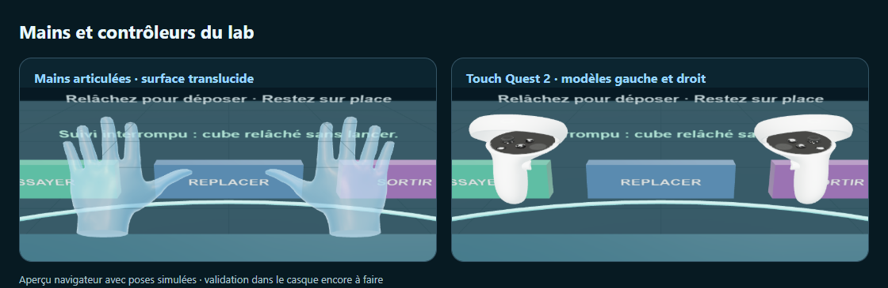

# Shared VR foundation

Open `?app=vr-lab` from **Ateliers → Atelier VR** on the GraphysX welcome page.
This is an opt-in first consumer of the shared renderer, not a replacement for Cyber Race
or the separate Ballsy prototype. The ordinary desktop routes do not load the XR factories.

## What is implemented

- Explicit **Entrer en VR**, retry, cancel while starting, exit and re-entry. No automatic
  immersive request. Unsupported browsers retain a usable 3D preview.
- A stationary, meter-scale workshop with headset instructions and three 3D buttons.
  Trigger/pinch activates a button. Grip/pinch picks up a cube; releasing puts it down.
  The cube's color and transform are changed through the ordinary `host.api.update`.
- Official Three.js `XRHandModelFactory` with locally bundled, skinned left/right hands.
  Their translucent ice-blue surface and bright rim follow the 25 native WebXR joints.
  Its compacted `spheres` profile remains visible while loading, on failure, or when a
  joint is missing. A surface never keeps drawing an untracked finger's last pose.
- Official `XRControllerModelFactory` with locally bundled white Touch controllers and
  tracking rings for the `oculus-touch-v3` (Quest 2) input profile. Left/right meshes,
  triggers, grip buttons, face buttons and thumbsticks use the profile's native animation.
  Other devices retain the GraphysX **generic** model; unknown mappings keep a grip and ray.
  No fingers are claimed to be tracked around a controller.
- Immediate procedural grip/ray fallback while a model loads or if an asset fails.
- Source/pose loss, visibility interruption and session end cancel held actions.
  A canceled release is distinguishable from an intentional release. It never implies a throw.
- Optional `local-floor` and `hand-tracking`; neither is mandatory. A `local`-only runtime
  gets a documented 1.6 m eye-origin offset. There is no automatic locomotion or camera chase.

## Module boundaries

`src/xr/vr-session.ts` owns one session. It calls `requestSession` synchronously from
`enter()` before awaiting anything, guards repeated requests, retains failed-end ownership
for retry and ignores stale asynchronous callbacks. It is dependency-injected and tested
without a browser. Call `checkSupport()` explicitly after construction.

`src/xr/vr-input.ts` owns native ray/grip/hand spaces, factory models and action events.
Slot index is never used as handedness. A fresh factory surrogate per connection isolates
late asset callbacks from a replacement source, including Three r179's asynchronous
connect/disconnect model-loading edge case. Factory GLTF failures leave the fallback usable.
The r179 primitive hand updater is wrapped to compact visible instances after its update:
missing joint poses cannot leave stale spheres drawn or truncate other tracked fingers.
Disposal releases both shared primitive geometry/materials and the owned instance buffers.
Surface loads use the same connection isolation. A late hand asset is disposed rather
than attached to a replacement source. Skinned skeletons and embedded controller textures
are also disposed with their models. Surface loading is cosmetic and never blocks pinch.

`src/xr/platform-vr.ts` adapts those pieces to `PlatformHost`. Construct one adapter on a
**scene-mode** host. A second adapter or an editor/play host is rejected; switching surfaces
while a session exists exits VR. Apps that need their own driving/editor behavior must define
and test that adapter policy first. Dispose the adapter before disposing the host.

The adapter supplies a separate tracked camera under a floor-position/yaw rig. Desktop
framing, pitch, chase and third-party camera subscribers cannot move the headset camera.
The audio listener follows the active camera. `PlatformHost` keeps its one existing
`setAnimationLoop`, simulation and normal frame subscribers. During immersion it skips:

- desktop camera advance/chase/orbit;
- EffectComposer/SMAA/bloom;
- planar reflection refresh;
- desktop 2D overlays and after-render inset callbacks;
- renderer resizing while the real XR framebuffer is active.

The desktop camera was never overwritten. On exit, the audio listener, controls, resizing,
postprocessing and insets resume. Hidden/blurred sessions cancel **input**, not world
simulation; an app needing pause must implement that rule itself. No secondary frame loop,
service, bridge, SDK renderer, multiplayer authority or scene schema is introduced.

### App action contract

`new PlatformVr(host, { position: [x, floorY, z], yaw, onAction })` produces:

- `action`: `select` or `grab`;
- `phase`: `start` or `end`;
- `source`: the actual `XRInputSource`, with `handedness` also copied for convenience;
- `anchor`: Three Object3D at the controller grip or thumb/index midpoint;
- `ray`: the native target-ray Object3D;
- `cancelled`: true for interrupted releases.

Read world coordinates using `anchor.getWorldPosition()` / `getWorldQuaternion()`.
Do not retain a held state when `cancelled` is true. Hands map native select (pinch) to
`grab`; controllers keep trigger select and grip squeeze separate. The first lab uses
pinch/grab on buttons as well, without requiring simultaneous hand and controller tracking.
A hand can retain valid finger joints while its target ray is unavailable. Consumers must
check `ray.visible` before ray actions. The lab allows near pinches in that state, refuses
remote/button hits, and cancels a distant hold when its ray disappears.

This is the seam for Ballsy's future paint/slime balloons. Ballsy owns the near-object
selection, tracked pose history, velocity validation, world/table-scale conversion,
projectile physics and temporary slowdown. Those game rules are deliberately absent here.
The lab's cube is placed, not thrown, collision-solved or manipulated with two hands.

## Assets and dependencies

There is no new package dependency. Source baseline uses Three `^0.179.1`; factories were
inspected in the installed r179 implementation. `scripts/build-xr-controller.mjs` regenerates
the GraphysX generic fallback. `scripts/vendor-xr-models.mjs` restores the hands, Touch
controllers and their MIT notice from pinned `@webxr-input-profiles/assets@1.0.20`, checking
SHA-256 before writing. These five model/profile files add about 1.5 MB; GLB geometry and
textures are embedded. The manifest ships every file, including the license, and
`test/vr-assets.test.mjs` validates hashes, all 25 hand bones, animation nodes and packaging.

Upstream source: [WebXR Input Profiles assets](https://github.com/immersive-web/webxr-input-profiles/tree/512311614a8557f0ef8bd3929889008bbf37381c/packages/assets).
The four meshes are unchanged. The packaged Touch JSON corrects upstream root/component
names to nodes present in its GLBs and removes the left menu's nonexistent visual animation;
the menu's button mapping is retained. The vendor script reproduces these edits and checks
both upstream and adapted hashes. Trademarks in the unmodified hardware meshes identify the
physical device; see the upstream asset README and bundled `profiles/LICENSE.md`.

No model-CDN request is needed. Real tracked input is not sent to a remote service.
A custom consumer must not silently replace the local profile path with a remote model source.

### Meta IWSDK decision

The official project is https://github.com/meta/immersive-web-sdk and describes a Three alias
pointing to `super-three`. That is an integration difference to investigate, not an assumption
of drop-in compatibility.

IWSDK is not installed in this checkout. Its current peer-version/renderer constraints have
not been verified in this task, so compatibility is **not** claimed. A framework migration is
not justified by the input visualization requirement: native Three factories already fit the
existing renderer, canonical scene API and one-loop architecture. Evaluate IWSDK in a separate
compatibility spike only if its interaction/authoring features justify that integration cost.

Reference implementations inspected locally:
`three/examples/jsm/webxr/XRHandModelFactory.js`, `XRHandPrimitiveModel.js`,
`XRControllerModelFactory.js`, `libs/motion-controllers.module.js`, and
`three/src/renderers/webxr/WebXRManager.js`.

## Running and validation

For a simple Windows preview of the existing build, double-click `Start-VR-Lab.cmd`
or run `node scripts/serve-vr-lab.mjs`. It binds only `127.0.0.1:4317`, exposes no
agent/API relay, refuses to replace an occupied port, and stops after 12 hours or Ctrl+C.
Use `VR_LAB_PORT` for another local port and `VR_LAB_HOURS` for a duration up to 24 hours.
This preview does not rebuild source changes. Its launcher smoke is
`node --test scripts/smoke-vr-preview.mjs` and requires an existing production build.
Use the repository's Node version and installed dependencies. Run normal `npm run dev`, then
open the printed localhost URL with `?app=vr-lab`. Browser-local localhost can test desktop
fallback; a Quest visiting a computer's plain LAN HTTP address cannot use immersive WebXR.
Use an already trusted HTTPS origin or an authorized headset-local development route.
Never disable security warnings or certificate checks to make XR work.

Focused checks:

```
node --test test/vr-session.test.mjs test/vr-input.test.mjs test/vr-assets.test.mjs
npm run typecheck
npm run lint
npm run verify -- --wait --checks=vr-lab
```

The `vr-lab` browser smoke loads the built app, verifies desktop/mobile UI and same-origin
models, and substitutes **only** the headset binding and native input poses. It exercises
entry rejection/retry, optional floor fallback, hands/controllers, button animation,
source/pose/visibility interruption, desktop camera preservation and post/inset restoration.
It is not a headset emulator or proof of real stereoscopic rendering.

Heavy captures/builds/smokes must use the existing machine-global verify lock. On a tool host
that redirects `LOCALAPPDATA`, ensure all cooperating processes resolve the same real lock
path. Use an existing installed browser through `SMOKE_CHROMIUM` if its cache discovery is
redirected; do not install another browser or change machine settings unnecessarily.

## Physical-headset acceptance still required

1. Open a trusted HTTPS page in Quest Browser or a working PC OpenXR browser.
2. Confirm the scene floor/scale and a comfortable stationary spawn, with an unobstructed area.
3. Enter using the visible button; inspect both-eye stereo, frame pacing and text readability.
4. Try each controller independently, reversed connection order, and trigger/grip/button travel.
5. Put controllers down and enable hand tracking. Inspect the translucent surface and pinch/release,
   including the joint fallback on incomplete tracking and recovery to the complete surface.
6. Lose a hand/controller behind the head, remove a source, open the system menu, and return.
   The cube must release safely and never re-grab until a fresh gesture.
7. Use the in-world exit and the headset's exit separately, then re-enter. Desktop framing,
   preview controls and other applications must remain usable.
8. Verify local-floor and seated/local fallback comfort on actual runtimes. A simulated 1.6 m
   origin is not proof of real device ergonomics.

No physical headset, hand-tracking permission prompt, optical tracking, mixed-input behavior,
comfort, real audio or performance acceptance was performed by the automated checks.

## Local validation receipt (2026-11-07 UTC)

Source: local branch `codex/shared-vr-foundation`, initial implementation commit `e7bc05b` plus the final partial-joint visibility fix,
based on the locally available `origin/main` commit `61f67b7`. No remote freshness,
publish, merge or deployment is claimed.

- Production Vite build, TypeScript and whole-repository ESLint: passed.
- Focused XR tests: 27 passed, 0 failed.
- Complete Node test run: 958 tests, 953 passed, 4 failed, 1 skipped, none cancelled.
  Three failures are `EPERM` from directory `fsync` at `world-service/archive.mjs:41`.
  The fourth reads a missing checkpoint's `sha256` in `world-reliability.test.mjs`.
  These persistence paths are outside the VR changes. Durability checks were not weakened.
- Windows test-config URLs were corrected with `fileURLToPath` in a separate local commit
  (`cf4735f`), exposing those persistence failures instead of failing to resolve config files.
- Built-app VR smoke: passed with no JavaScript errors. Includes permission rejection,
  retry, entry/exit/re-entry, controller animation, grip and native pinch, target-ray loss,
  reference-space reset, visibility interruption, local-only reference fallback, malformed
  model fallback, and desktop camera/composer/inset restoration.
- Seven unchanged browser regressions passed: showroom, showroom camera, editor,
  standalone, games, Cyber Race and overlay. They ran serially against build `e7bc05b`.
  The later input-only partial-joint fix was rechecked by the focused tests and VR smoke.
  The separate Ballsy development branch was not merged into or migrated to this adapter.
- Browser images of input models use synthetic poses with the cube and desktop panel hidden
  for that capture only, so the geometry is not occluded. They are not headset screenshots.

Local reproducible evidence is under `output/vr/`: `final-patch-receipt.json`, `static-receipt.json`,
`all-unit-final.log`, `build-final.log`, `vr-lab-receipt.json`, `browser-final.log`,
`regression-receipt.json`, `regressions-final.log` and the corresponding screenshots.
These ignored artifacts are not published.
The full repository gate is not green; the physical-headset checklist above remains open.

## Reference-style input update (2026-11-07)

Branch `codex/vr-hands-touch`, based on `origin/main` at `5952c94`. The owner's target is
Quest 2 in its own browser. The native `oculus-touch-v3` profile now selects the matching
white controllers instead of generic boxes. Complete hand tracking selects the local
skinned surface; hand tracking must be enabled on the headset to supply that input source.



The picture combines two cropped screenshots of the real built lab. Only input poses and
headset binding are synthetic; the desktop panel and cube are hidden for model visibility.
The hand screenshot uses the asset's bind pose normalized at the wrist, without changing
the production mapping of native joints.

Validation:

- 32 focused XR tests pass, including both real hand GLBs, incomplete/missing joint spaces,
  recovered poses, stale asynchronous loads, skeleton disposal and shared texture disposal.
- TypeScript, repository ESLint and the production build pass. Re-running the vendor script
  reproduces the committed asset hashes and the adapted profile.
- Built-app browser checks pass under the existing Windows Edge: VR lab, Ballsy shared VR
  (50 checks), showroom and Cyber Race, with no browser errors. A final lab disposal cleanup
  was rechecked with the focused tests and lab journey.
- The complete Node run reports 1,241 tests: 1,236 passed, 4 failed, 1 skipped. The same four
  failures were reproduced in the unmodified `0938675` checkout: three Windows directory
  `fsync` errors at `world-service/archive.mjs:41` and one missing checkpoint's `sha256`.
  The normal verifier stops at that unit step; the four browser checks therefore ran
  separately under the machine-global verify lock. No full release gate is claimed.
- The first Playwright Chromium Ballsy attempt timed out discovering its relay before XR
  entry. The existing Edge run passes without altering product timeouts or assertions.

Detailed local evidence is in `output/vr-visuals/`: `xr-final.log`, `typecheck-final.log`,
`lint-final.log`, `build-final.log`, `unit.log`, both `baseline-world-*.log` files,
`browser-final.log`, `browser-summary.json`, `vr-lab-final.log` and per-journey receipts
under `browser/`. These logs remain ignored. No headset, stereo, optical tracking, comfort,
audio or Quest frame-rate acceptance is claimed; publication is separate from this change.
